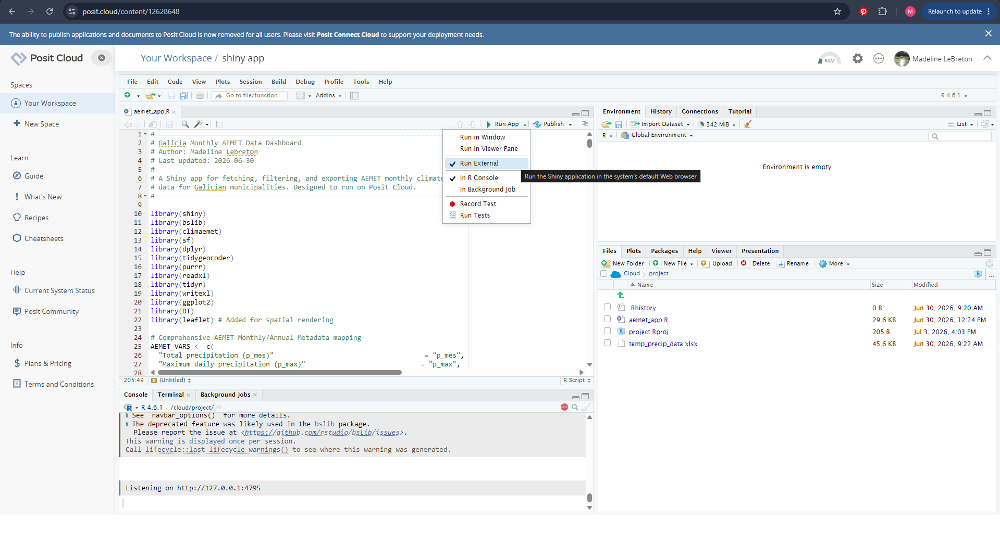
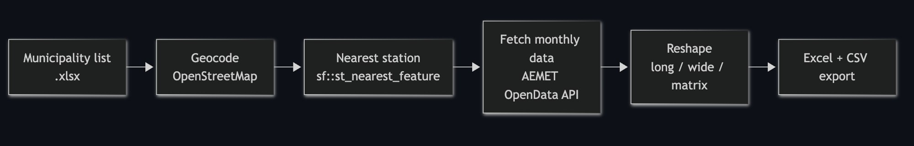
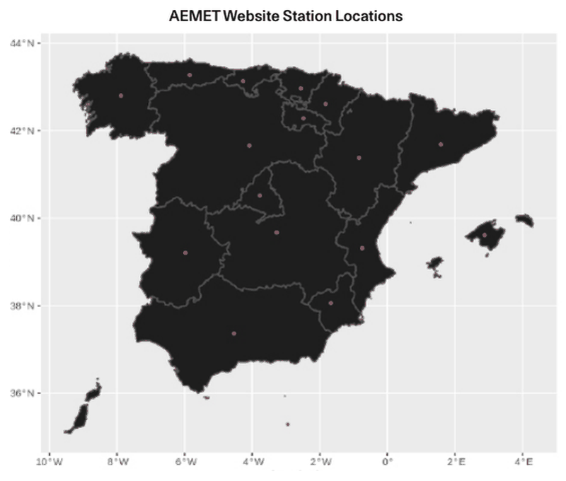
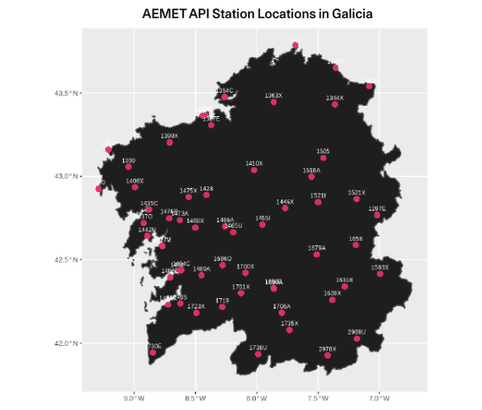
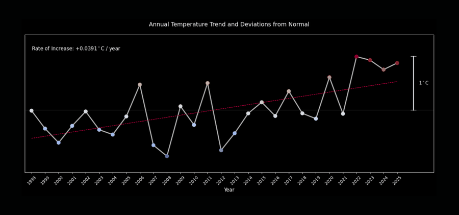
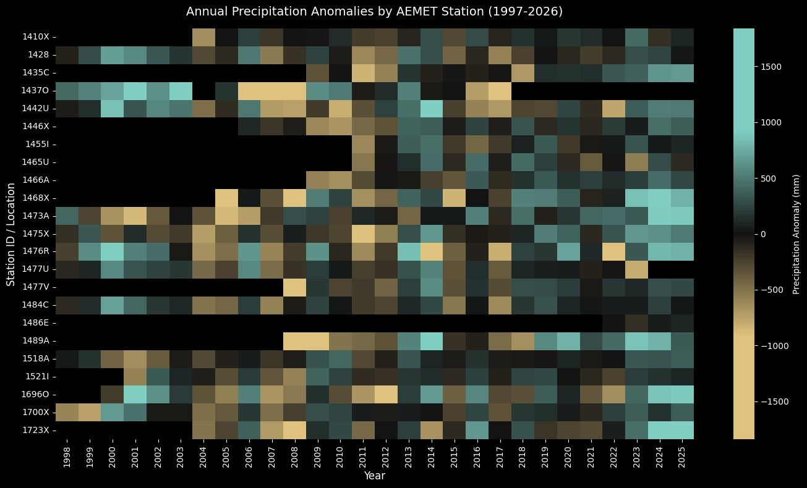
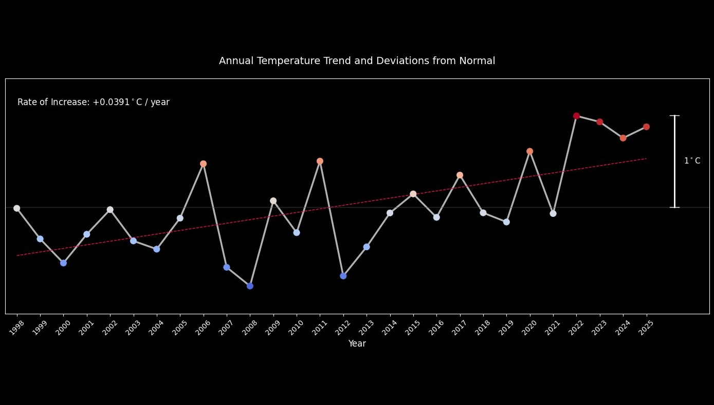
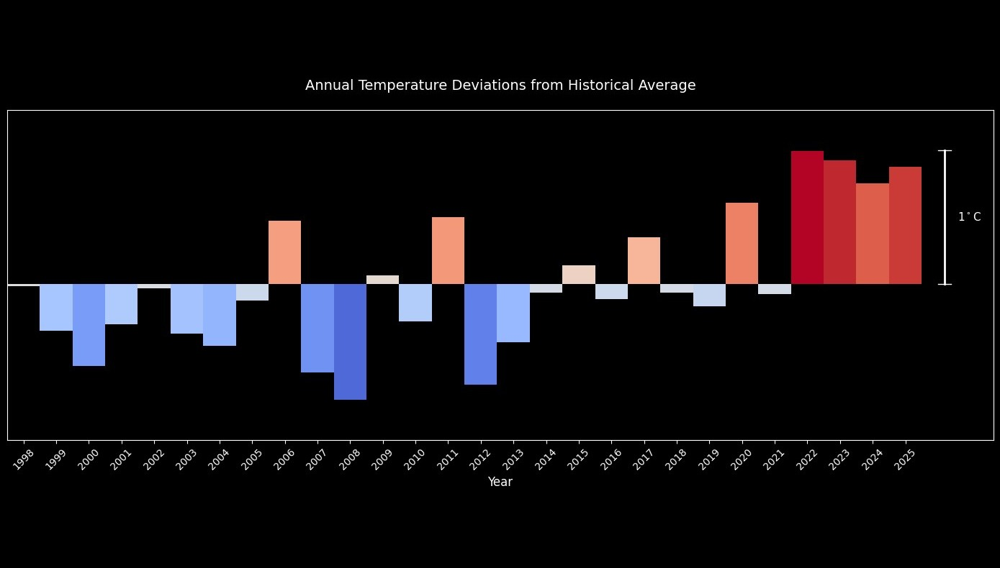

An interactive R Shiny app that turns open data from AEMET, Spain's national weather service, into data tables for any list of municipalities, with no code required from the user. Upload a spreadsheet of municipalities and the app geocodes them, matches each to its nearest AEMET weather station, pulls monthly climate records for the years you choose, and exports tidy Excel workbooks.

## Why I built it

I built this geospatial analysis framework during my internship at Fundación RIA, using R and Python to make environmental data more accessible to architects. Getting climate records out of AEMET normally means API calls, station lookups and reshaping data by hand. The app wraps that whole workflow in a four-step interface so people who are not comfortable writing code can get the data they need.

## What it does

| Step | Tab | What happens |
|---|---|---|
| 1 | Setup | Connect with your AEMET API key, choose one of 24 AEMET monthly variables (precipitation, temperature, humidity, pressure, wind and more), and upload a municipality list. |
| 2 | Stations | Geocode each municipality via OpenStreetMap, match it to the nearest AEMET station, and inspect the matches on a Leaflet map and in a table. |
| 3 | Data | Choose stations and a year range, fetch the data from AEMET, and preview faceted time series. |
| 4 | Export | Download an Excel workbook and the table of stations as CSV. |

The pipeline diagram below shows the same flow, from a municipality list to the export.

## Output workbook

| Sheet | Shape | Use |
|---|---|---|
| `station_month_matrix` | One row per month, one column per station | Quick charting in Excel |
| `wide` | One row per station and year, Jan–Dec columns plus yearly max, min, mean and sum | Comparing years |
| `long` | One row per station and month | Tidy format for R, Python and QGIS |

The municipality file is an `.xlsx` with three columns: `NOMECAPITA` (the administrative seat), `CONCELLO` (the municipality) and `PROVINCIA` (A Coruña, Lugo, Ourense or Pontevedra). An example list of eleven Galician municipalities is previewed below and included in the repository.

<figure class="sheet">

example_municipalities.xlsx

<table>
<thead><tr><th></th><th>A</th><th>B</th><th>C</th></tr></thead>
<tbody>
<tr class="hdr"><th>1</th><td>NOMECAPITA</td><td>CONCELLO</td><td>PROVINCIA</td></tr>
<tr><th>2</th><td>A Coruña</td><td>A Coruña</td><td>A Coruña</td></tr>
<tr><th>3</th><td>Ferrol</td><td>Ferrol</td><td>A Coruña</td></tr>
<tr><th>4</th><td>Santiago de Compostela</td><td>Santiago de Compostela</td><td>A Coruña</td></tr>
<tr><th>5</th><td>Lugo</td><td>Lugo</td><td>Lugo</td></tr>
<tr><th>6</th><td>Monforte de Lemos</td><td>Monforte de Lemos</td><td>Lugo</td></tr>
<tr><th>7</th><td>Viveiro</td><td>Viveiro</td><td>Lugo</td></tr>
<tr><th>8</th><td>Ourense</td><td>Ourense</td><td>Ourense</td></tr>
<tr><th>9</th><td>Verín</td><td>Verín</td><td>Ourense</td></tr>
<tr><th>10</th><td>Pontevedra</td><td>Pontevedra</td><td>Pontevedra</td></tr>
<tr><th>11</th><td>Vigo</td><td>Vigo</td><td>Pontevedra</td></tr>
<tr><th>12</th><td>Lalín</td><td>Lalín</td><td>Pontevedra</td></tr>
</tbody></table>

municipalities

<figcaption>Preview of the example municipality list: eleven Galician municipalities, one per row.</figcaption>
</figure>

## Technical notes

- **Spatial matching.** Municipalities are converted to `sf` points and assigned to the nearest station with `st_nearest_feature()`. Distances are reported in km and colour-coded in the results table, so a geocoding error is easy to spot.
- **Robust to incomplete data.** Partial years used to crash the wide-format reshape silently. The app now backfills missing month columns with `NA` and wraps each station request in `tryCatch()`, so one failing station is logged as a warning and the rest still load.
- **Mixed data types.** Most AEMET variables are numeric, but `w_racha` (maximum gust) is a composite string. The app detects this, keeps it as text and skips the numeric summaries and plot.
- **API etiquette.** AEMET allows 50 requests per minute, so requests are paced with a short delay and progress is shown per station.
- **No keys in code.** The API key comes from an environment variable or is typed into the app and held in memory for the session only.

## Visualization

A Python notebook in the repository analyses long-term temperature and rainfall trends in Galicia using the AEMET data. The charts show annual precipitation and temperature anomalies by station, the annual temperature trend and its deviations from normal.

<strong>Visualization notebook.</strong> The full notebook, with its code and outputs, is embedded below the charts. <a href="/AEMET_visualization.html">Open it in a new tab</a>.

## Running it

You need a recent version of R and a free AEMET OpenData API key. Install the packages once with the included script, provide your key (from an `.Renviron` file or by pasting it into the Setup tab), and start the app with `shiny::runApp()`. A public deployment, for example on shinyapps.io, needs no secrets on the server because each visitor enters their own key.

## Limitations

- Station matching uses straight-line distance and ignores elevation and terrain. A nearby station is not always the most climatically representative one.
- Geocoding relies on the public OpenStreetMap Nominatim service, so large lists are slow and misspelled names can fail.
- Not every station records every variable or year. Gaps are reported in the app and left as `NA` in the export.

Climate data © AEMET (Agencia Estatal de Meteorología); please follow AEMET's reuse and attribution terms. Geocoding and base map © OpenStreetMap contributors; map tiles by CARTO. Released under the MIT licence.
