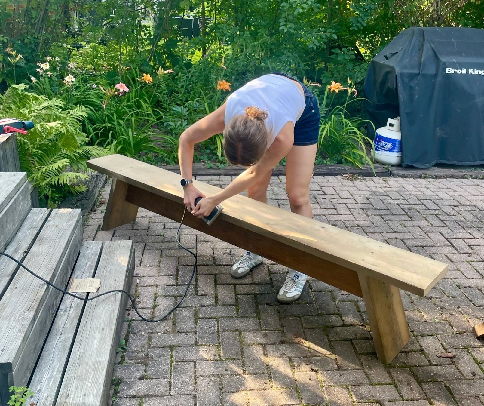
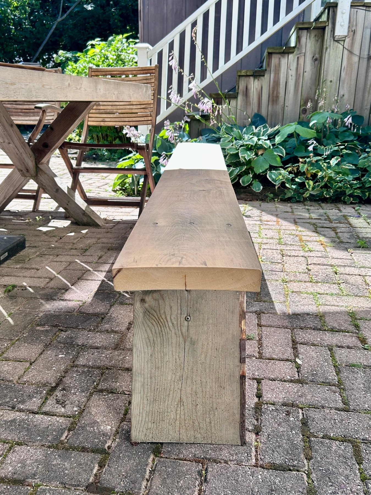
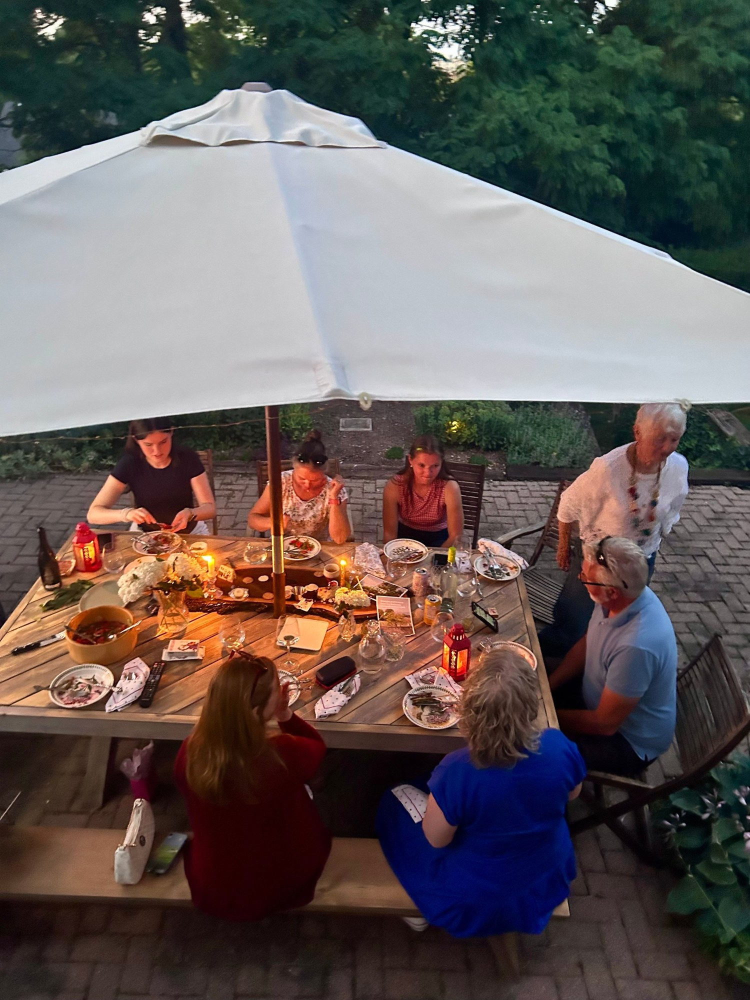
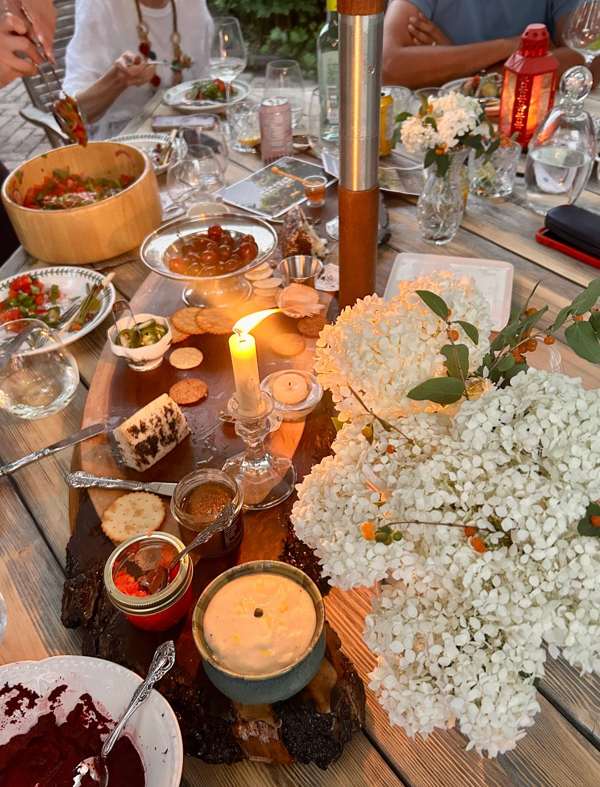
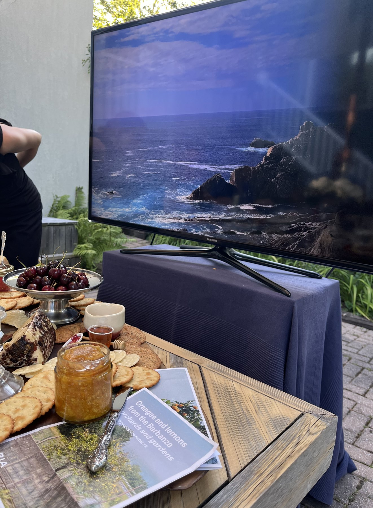
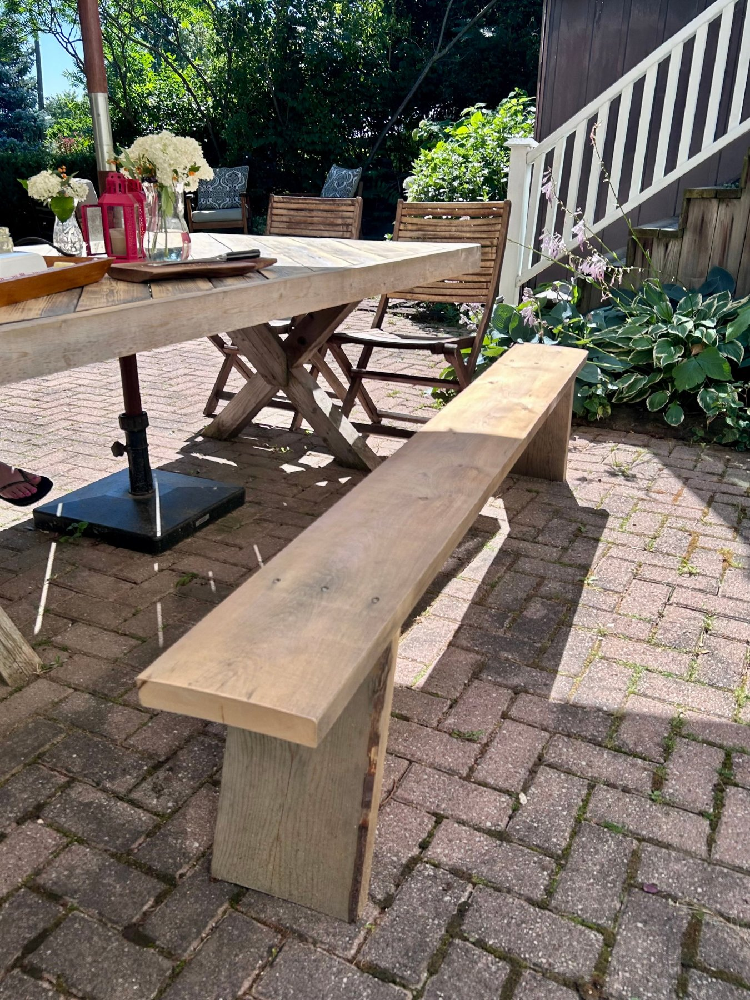

A creative project: a wooden bench made from repurposed wood for a backyard dinner party celebrating recipes brought home from Spain.

I designed the bench to seat more people at the table, and hosted a dinner inspired by my travels in Spain, sharing dishes and stories from my summer abroad.

