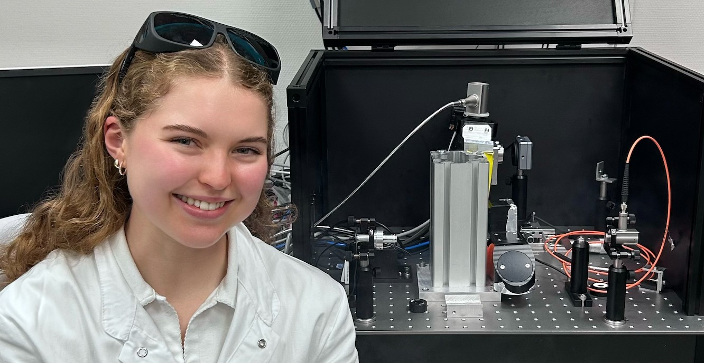
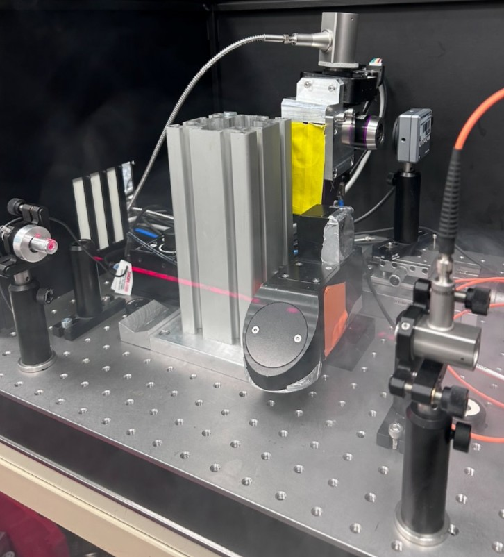
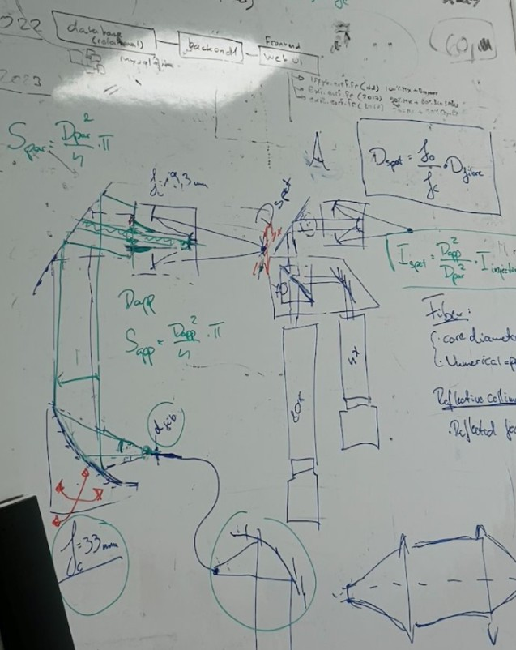
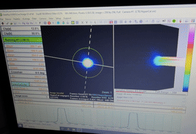
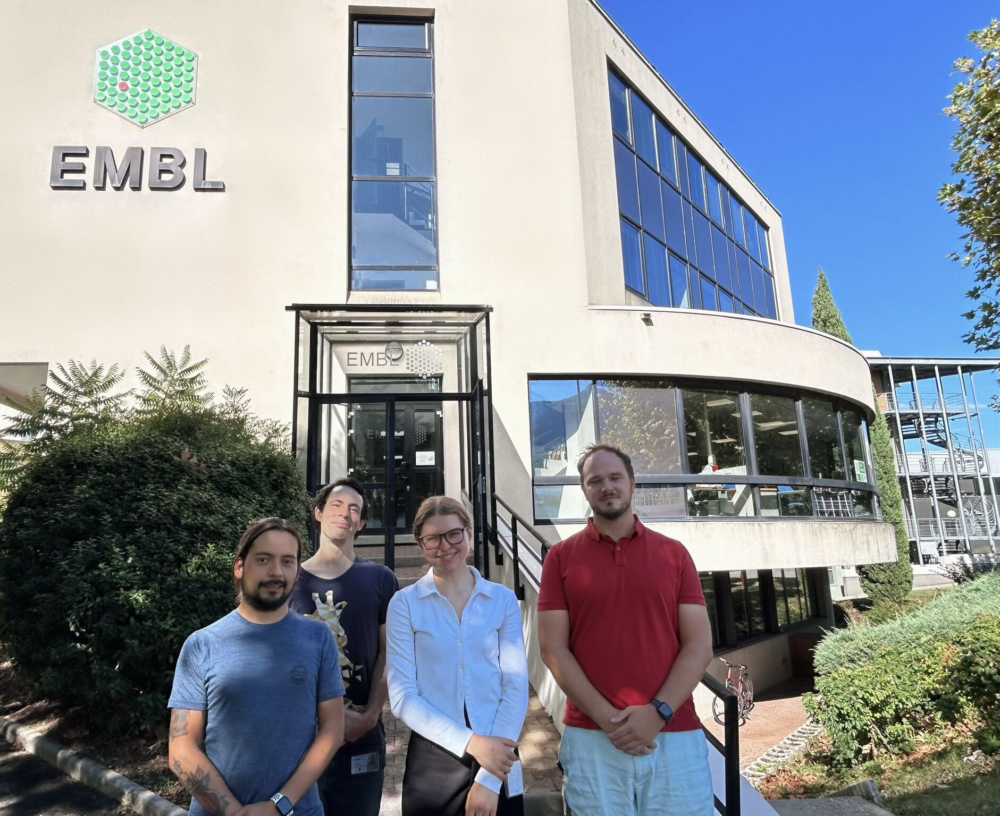
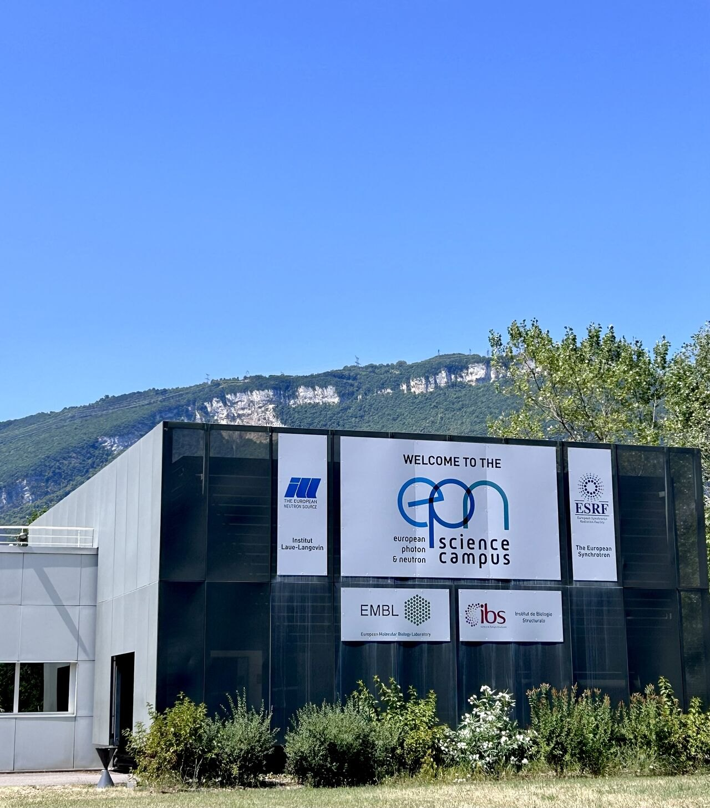
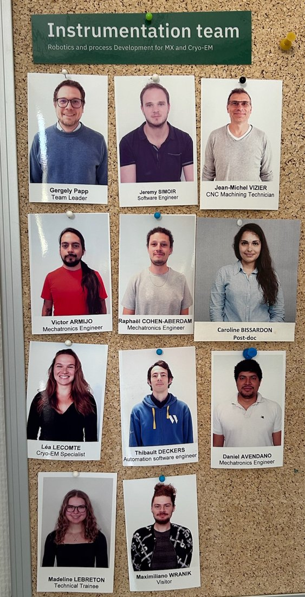
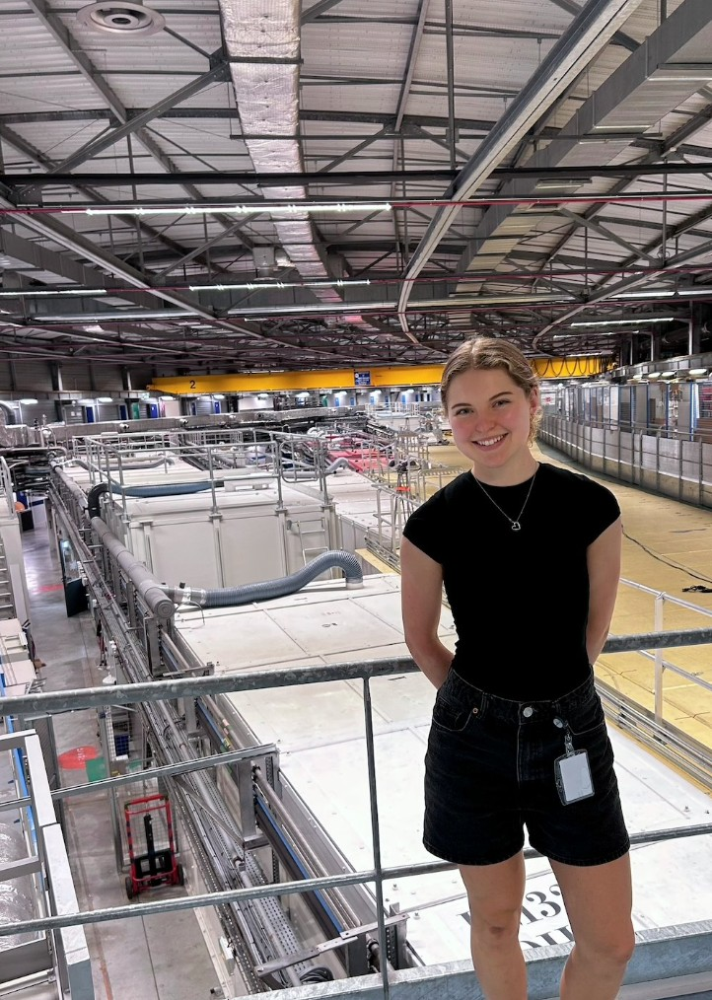
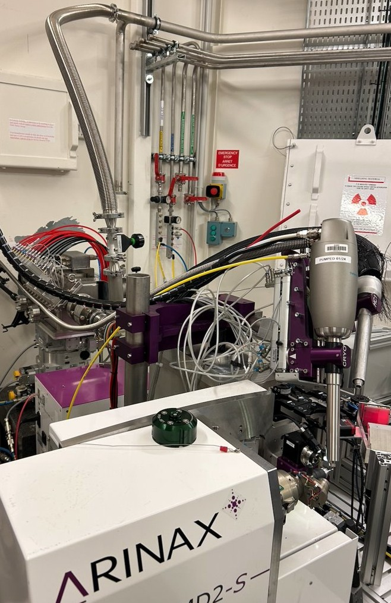

Project during my internship at the European Molecular Biology Laboratory's Instrumentation Team, which develops scientific instrumentation for synchrotron beamlines and cryo-electron microscopy.

I helped develop a motorized, wide-wavelength-range laser injection system for time-resolved macromolecular X-ray crystallography at the synchrotron, a collaboration between the European Synchrotron Radiation Facility and the EMBL. Light from lasers at several wavelengths is carried by optical fibre to a collimator and focused onto the sample by an objective, steered by a motorized gimbal. The optical design draws on photonics and precision instrumentation, which I learned during this work term.

## What I did

- **Theory.** Understood the optical design and built a theoretical model of the system for transmission rate and laser spot size.
- **Test bench.** Assembled and aligned the bench, first with a simplified, non-motorized version of the system for the initial evaluations, then with the custom designed and manufactured motorized system.
- **Measurement.** Wrote Python scan routines that interface a DataRay beam profiler, a power meter and the motorized gimbal, to automate transmission, spot size and ellipticity mapping across the gimbal range. I showed that the gimbal repeats a position within about ±6 µm and crosses its full range in 1.3 s at maximum speed settings.
- **Design fix.** Found that lower transmission in one corner of the range came from a misalignment in the mechanical design of the prototype. I took my analysis to the CAD engineering office with a proposed solution, and the critical parts were redesigned and re-manufactured, which gave a fully functional prototype.
- **Reporting.** Documented each test in structured technical reports, which the team shares with its collaborators at the ESRF and with industrial partners, and presented the results to a working group of beamline scientists and engineers from several institutions.

