

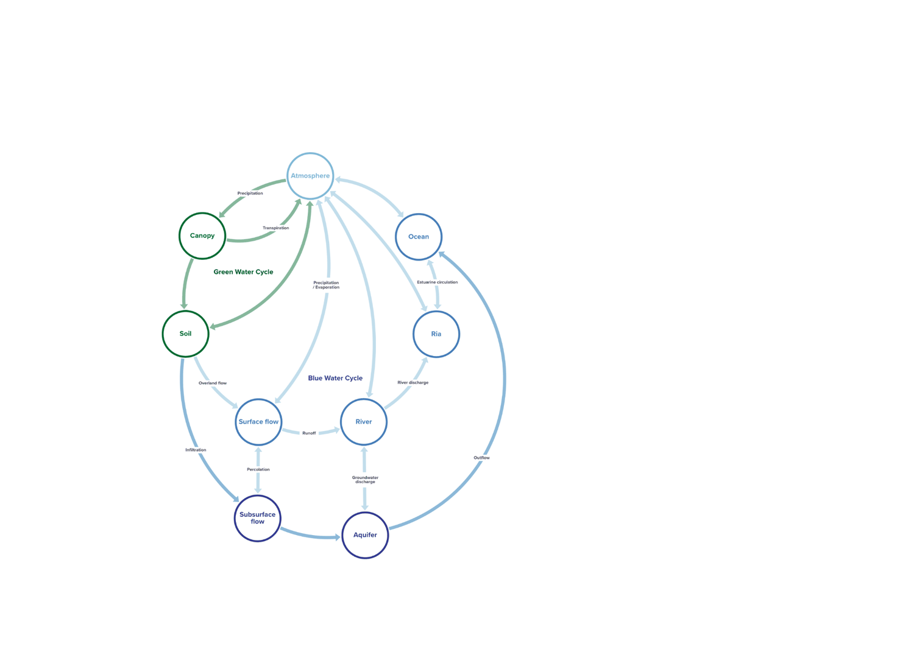

A systems map of the water cycle in Galicia, built in Kumu with Pablo Gallego Picard at Fundación RIA. Open the interactive version to explore each element and connection. The animation above builds the map up in steps: the water cycle loop first, then the human-activity themes around it, with the cultural importance cluster and pop-up descriptions in the interactive version. This page follows how the map was made, from a literature review to a finished diagram.

## Purpose

The literature review showed how connected the problems in Galicia's hydrologic cycle are. I wanted to represent that visually, so that someone could see the interdependencies and relationships at a glance instead of reading them in a report.

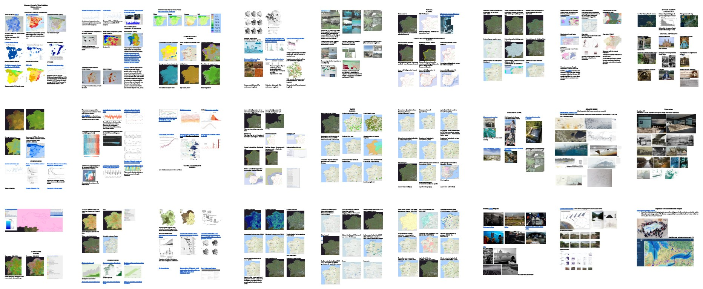

## Matrix of connections

I started with a matrix that asks "how does X affect Y?" for each pair of topics, for example how agriculture affects pollution, and how pollution affects agriculture. I colour coded the entries by the themes that kept appearing in the literature review, which let me look at where themes overlap. In the climate-to-pollution cell, for instance, storms introduce pollutants in runoff, which sits where climate change, clean water access and estuary farming meet.

The preliminary themes were clean water access, oceans, estuary farming, climate change, agriculture, highways and dams.

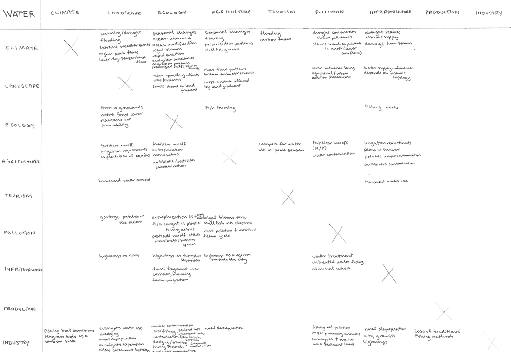
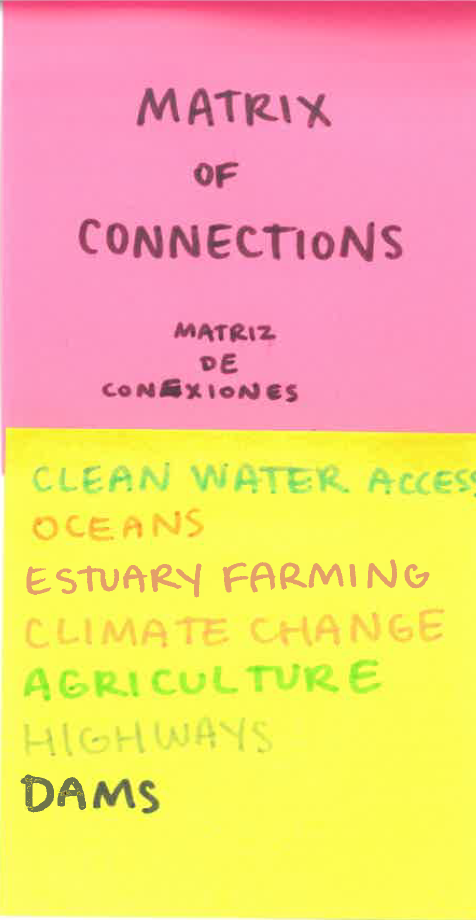

## Digging deeper into themes

I then went through each theme to see the full scope of its challenges. This turned out to be the first step of "gaining clarity" in the Systems Practice workbook from the Omidyar Group: explore the forces that keep the system unhealthy (inhibitors) and the forces that could nudge it toward a healthier state (enablers). I highlighted one theme at a time in the matrix and wrote notes underneath.

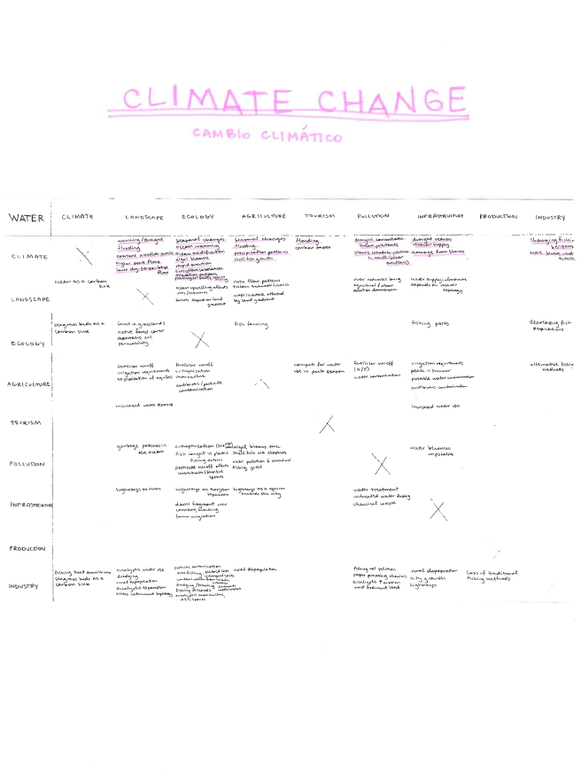
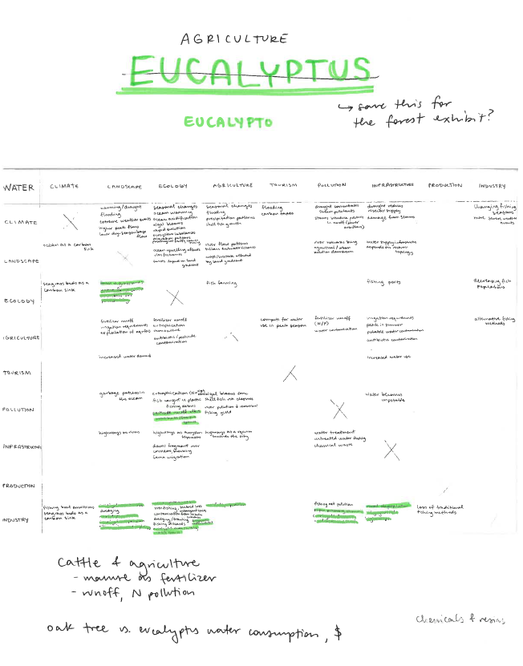
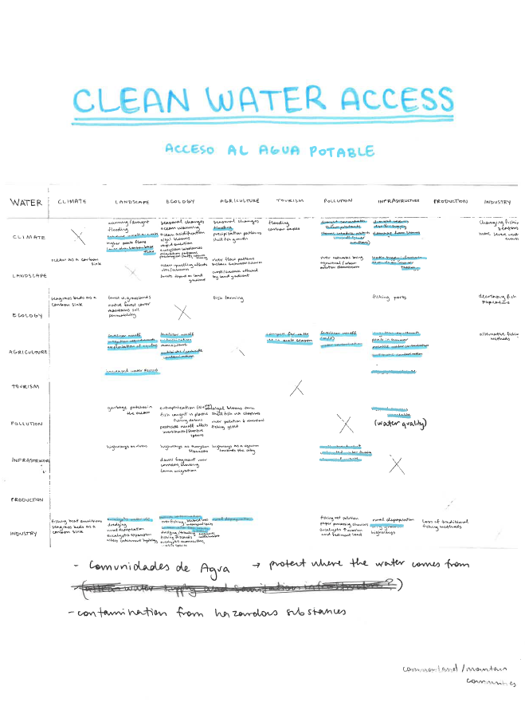

.")
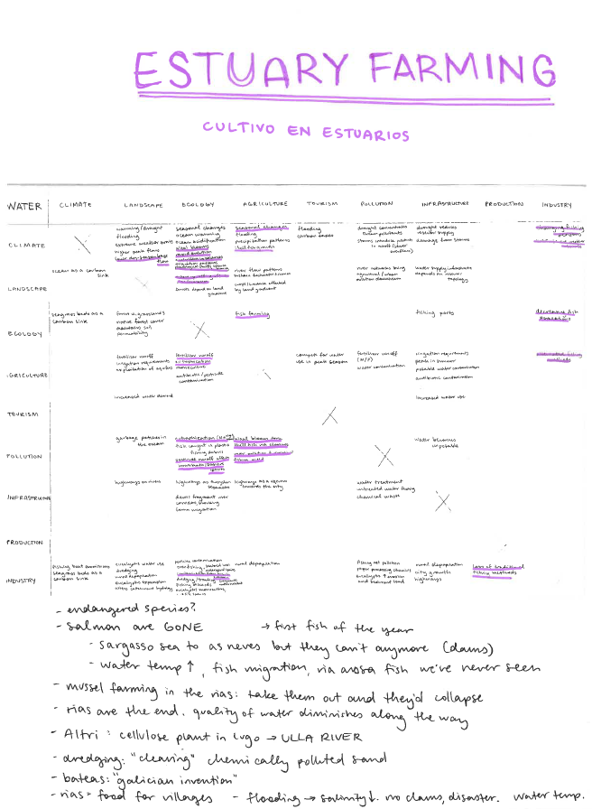
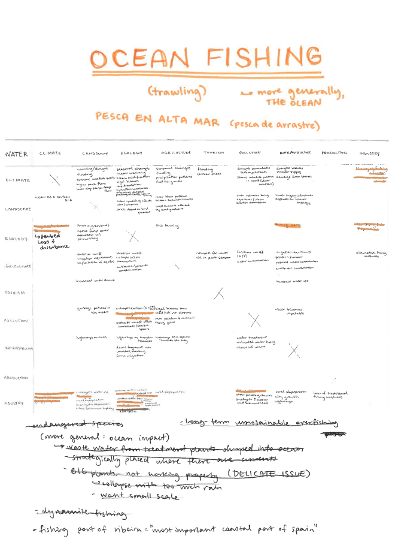

The broad sectors were a poor fit for how water behaves, so I considered renaming the themes to describe the water-related issue instead:

- Climate change became climate-driven hydrologic change.
- Agroforestry and land use became land use and watershed processes.
- Clean water access became water supply and quality.
- Dam management became dam and reservoir management.
- Estuary farming became estuary (ria) ecosystems and shellfish production.
- Ocean fishing became marine ecosystem and fisheries.

I could also organize them along the hydrologic system itself, so that the central loop of the diagram is the water cycle, an intuitive narrative, and each issue sits at the place it affects: climate and hydrologic change (atmosphere, precipitation), watershed land use (runoff), river regulation (river flow and riparian ecosystems), freshwater resources (groundwater and aquifers), estuarine systems and marine systems (the ocean).

## Drawing connections

Next I tried different ways of laying out the connections between the themes to find a concise narrative: by connection, by scale, in historical order and as a journey from cause to effect.

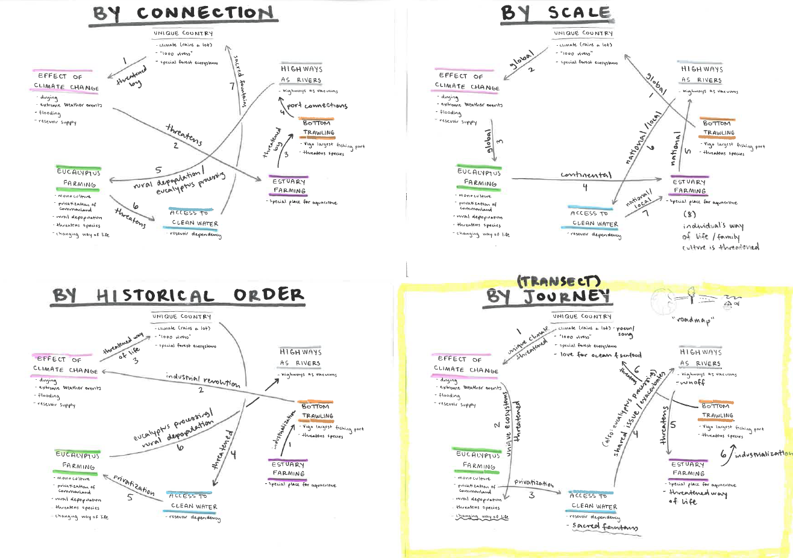
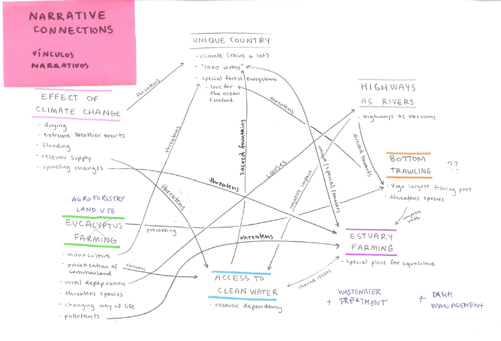

## Identifying gaps with Pablo Gallego Picard

A coffee chat with Pablo identified gaps that could not be understood through a literature review alone. Water quality matters a lot in Galicia. Cattle and agriculture pollute runoff with nitrogen, and dams and the privatization of public land came up as a cause of “water death”. As a proud Galician, he pointed me to cultural references, including the campano, the traditions of cleaning canals and the temple in Lugo, and explained that the map should show how small projects can have big impacts, because people need to be given hope. As a result I added the themes of cultural and traditional water knowledge, as well as governance fragmentation.

## Inspiration for the representation

I wanted a more visual diagram than a graph of connections. I was inspired by Kate Orff's work, "Drawing the Line on Oil" in *Petrochemical America: Ecological Atlas* (Aperture Foundation, 2012, developed with photographer Richard Misrach), which shows oil's pasts, presents and futures through its landscape impacts. [Orff, "Landscape Impacts of Petrochemistry"](https://doi.org/10.1215/22011919-8867186).

## Sketches

I began mapping the human effects on Galicia's hydrologic cycle by hand: causes, effects and impacts, and the cause and effect relationships between them. Most of the issues showed up as positive feedback loops. It was hard to iterate on paper, so I looked for a tool.

## Choosing Kumu

Kumu's system mapping guides and example maps showed what I needed. Its presentation mode has narrative and focus views, and a walkthrough that zooms in on each feedback loop, with loops explained alongside the drivers that act on them from outside the system. I also saw how a deep structure layer can sit underneath the main map.

## Systems practice

I followed the Omidyar Group's [Systems Practice workbook](https://www.socialchangeinnovators.com/site/templates/files/Systems%20Practice%20Workbook-012617%20Omediar%20Group.pdf), which describes an approach to systems practice in phases. I worked through the first phase, "gain clarity", whose steps are to explore forces, analyze causes and effects, create loops, discover the deep structure, build the map and craft a narrative.

## Causes and effects

To go deeper I looked at the causes and effects of each topic. I used Sticky Studio, which has a template for systems mapping and makes it easy to draw relationships between sticky notes. It is collaborative too, so a group can brainstorm in it together.

I mapped the sectors and topics within the human challenges. The result was messy, but easy to reorganize into the bigger picture. I then modelled some loops as prototypes that could be folded into the full map, separated the green and blue water cycles, and put the loop labels inside. The scope was getting large, so I looked at grouping nodes into summaries.

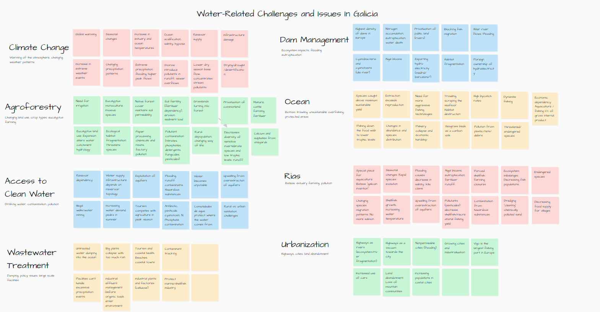

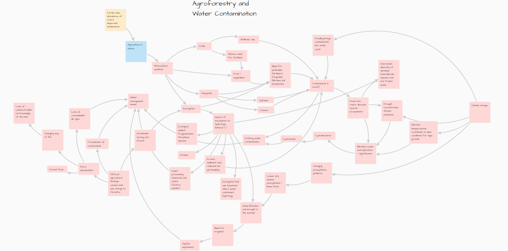

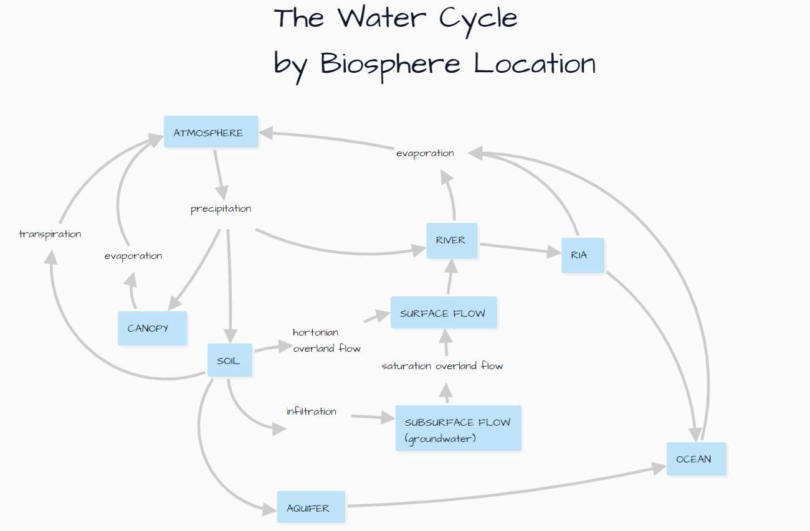
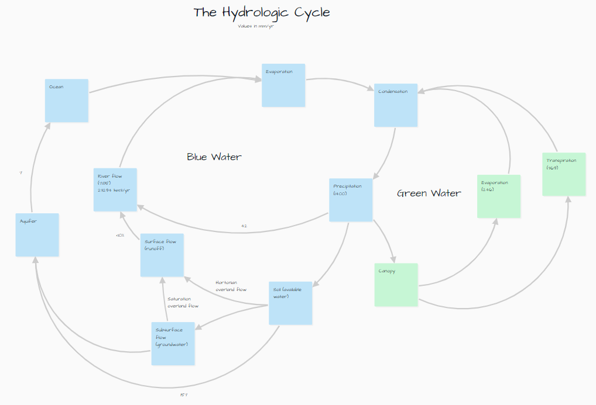

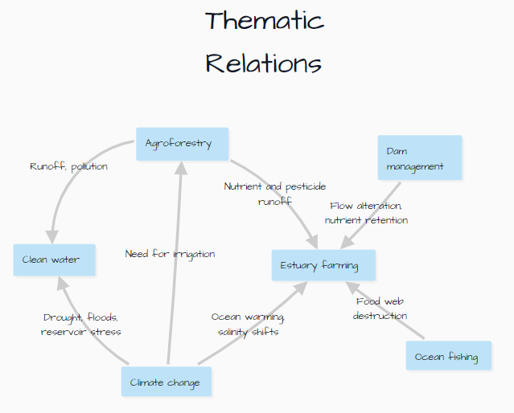

## Creating loops

I wanted to find the types of feedback loop at work in Galicia's water systems, so I analyzed the cause and effect relationships for loops. Sketching them revealed a pattern I called the shared impact loop: human impacts cause undesirable variations in the hydrologic cycle, which cause biological instability and a reliance on engineered control, and that in turn keeps destabilizing the natural equilibrium. I could use it as a narrative backbone to describe the pattern behind the other loops.

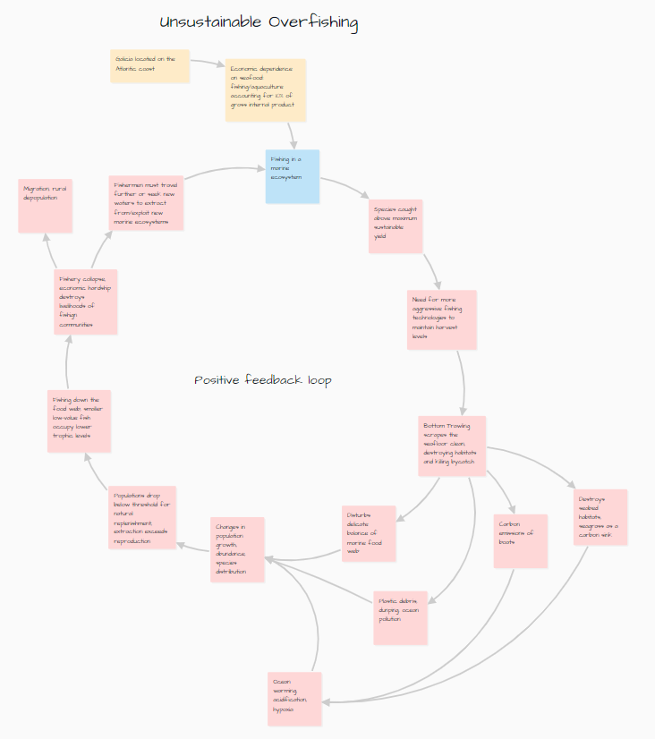
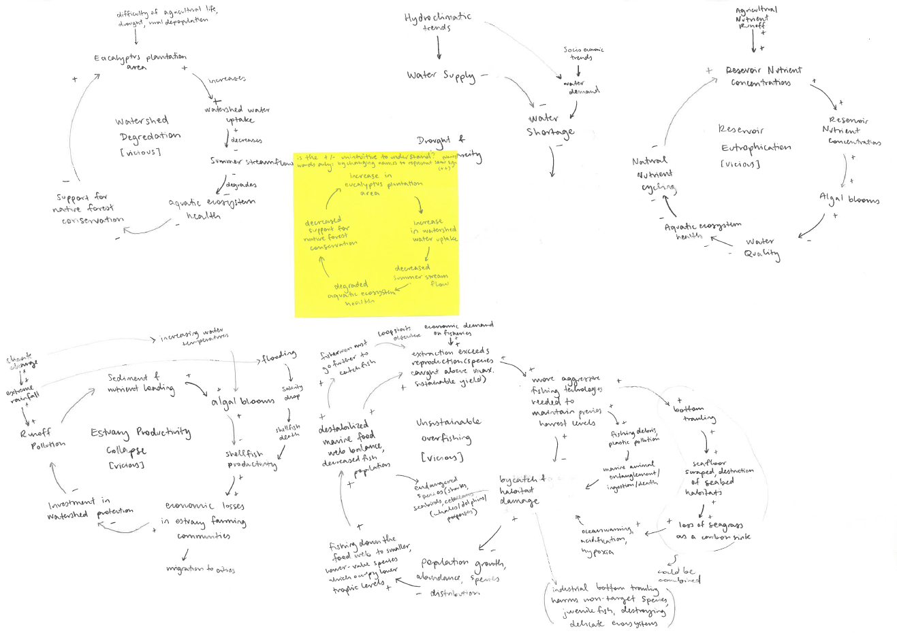

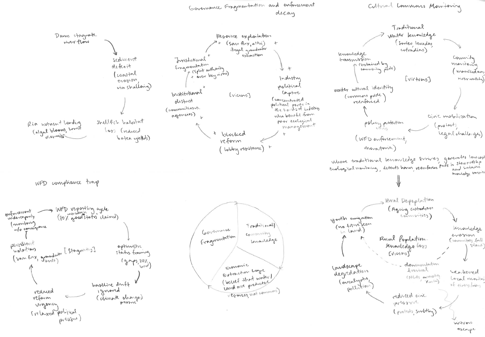

My first Kumu map showed the green and blue water cycles at three levels: the atmosphere, the ground surface and underground. I then redrew it as a circular loop, which is a more intuitive cycle. It has the same elements and connections, rearranged.

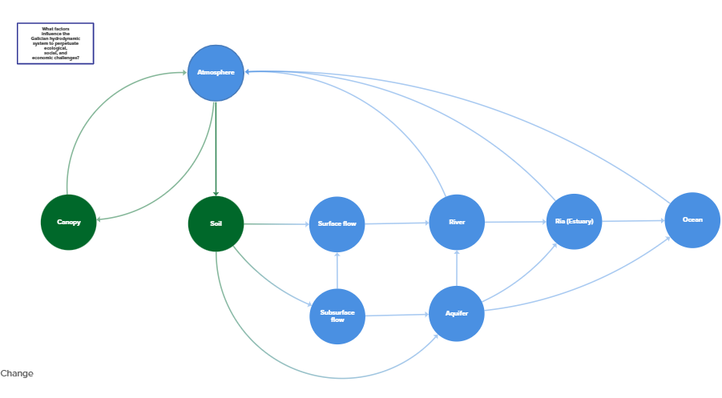
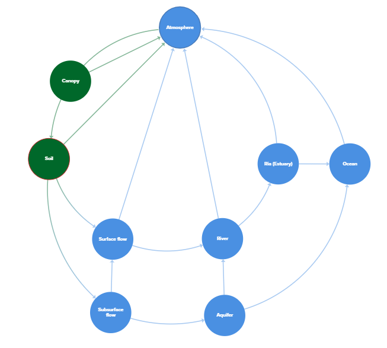

## Exploring what Kumu can do

I worked through Kumu's features. The basic element editor holds a label, a type, a description, tags and custom fields, and elements can include videos, images and images from a URL to support the narrative. I looked at clustering, which groups elements by rules such as skills needed and offered, at grids and guides for laying a map out, and at importing data from CSV, Excel or Google Sheets, with sample imports for systems mapping and geomapping. Kumu can also make geo maps with data explanations.

## Applying it to water in Galicia

I put the elements and connections in a spreadsheet (the water cycle matrix) with one sheet per theme, such as agriculture, groundwater, dams and reservoirs, water quality, rías, marine systems and biodiversity and society. Importing the elements, with connections made by tag, makes the map reproducible: I can add to the spreadsheet and re-import.

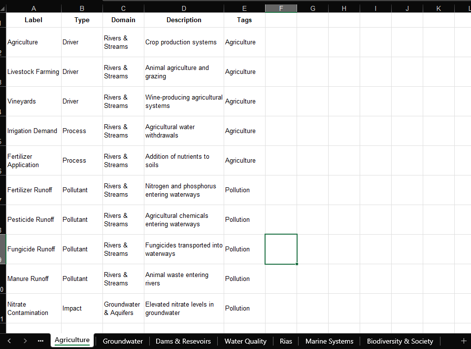

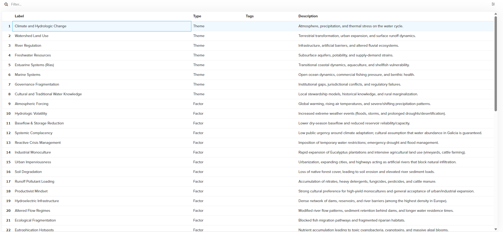

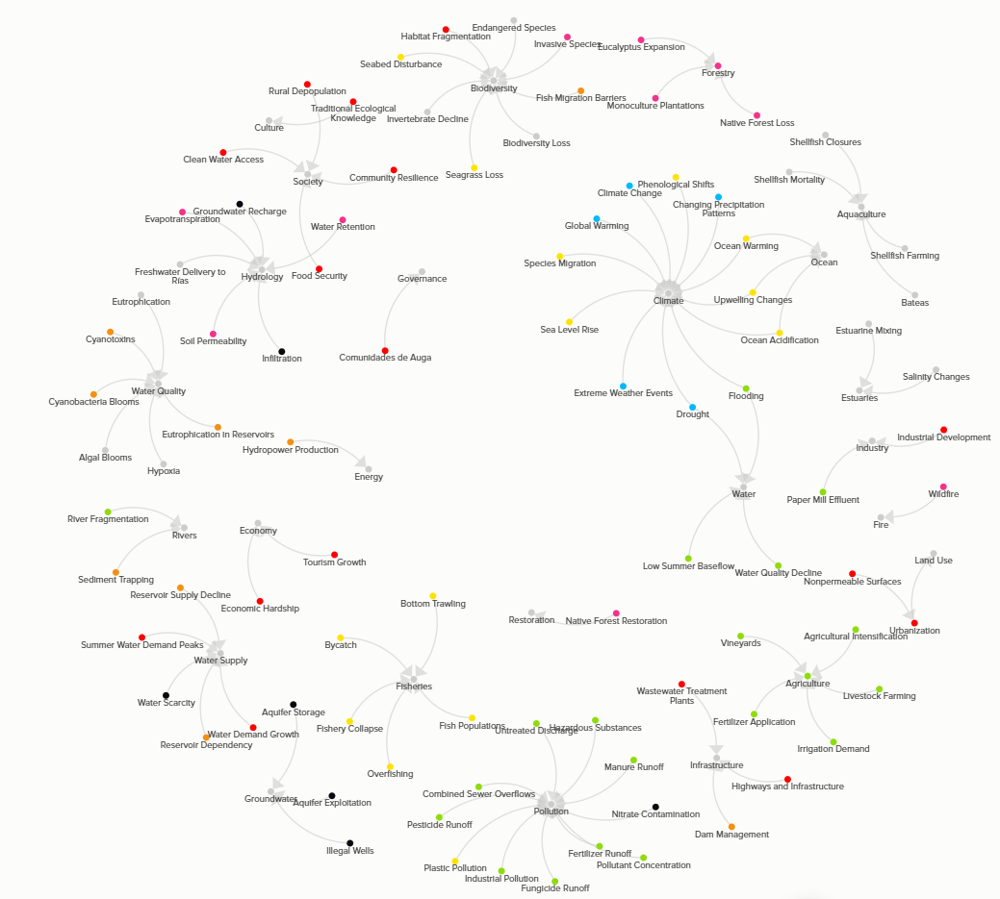

## What makes a good Kumu map

Looking at other Kumu maps taught me what works. A map with an illogical layout has no clear narrative, and one that looks jumbled takes too much thought to read even when the themes are colour coded. A successful map uses clear formatting to set a hierarchy of attention, with bigger text, thicker arrows and a different fill style for the main loop than for the connections around it. Formatting communicates the flow and nature of the connections. Kumu can also filter by date, which would show change over time, such as a 2010 view against a 2020 view.

## The resulting map

I built the final map in layers. The green and blue water cycles form the main loop, and each human-activity theme sits around it, linked to the part of the cycle it affects, with feedback links between themes.

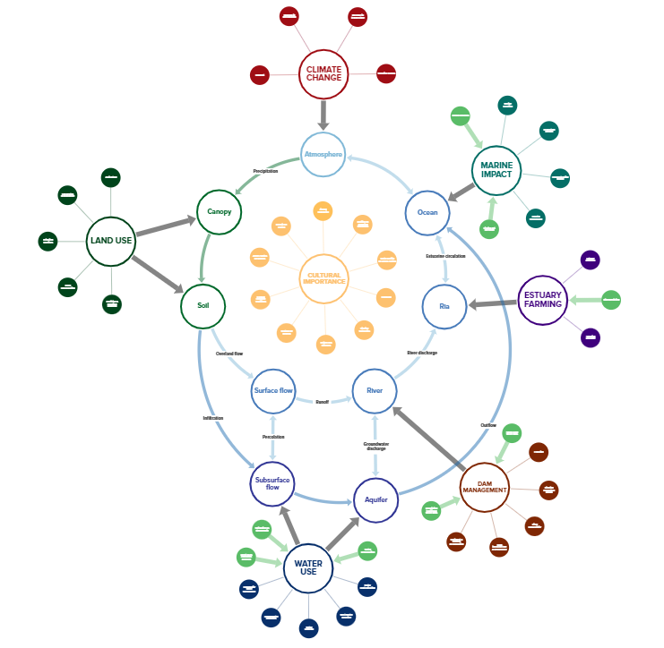

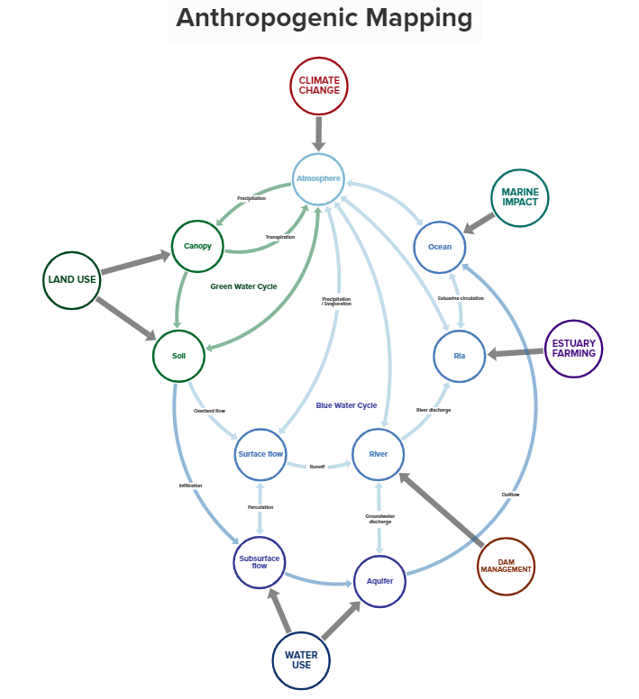
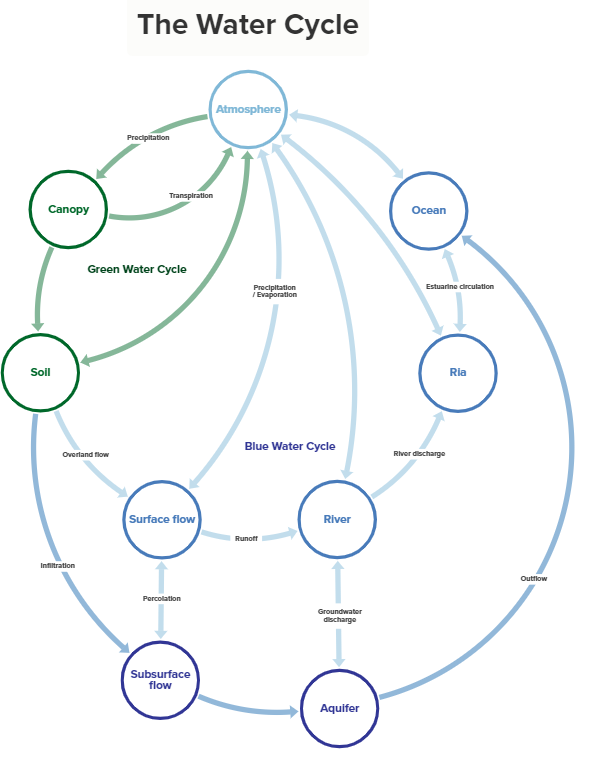

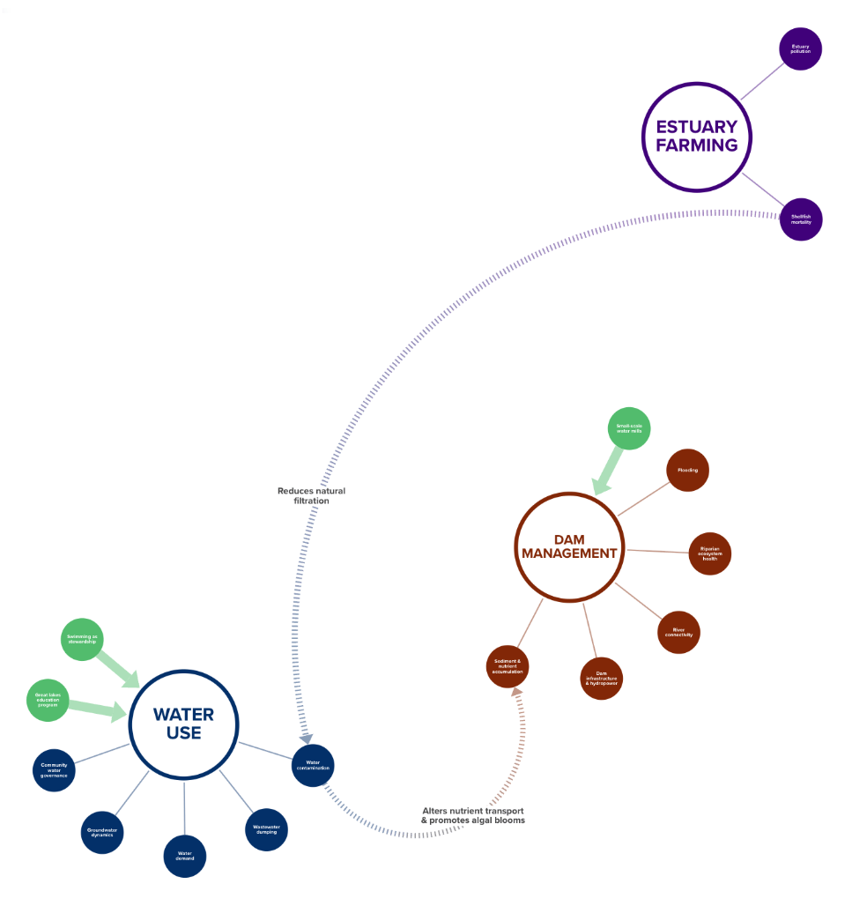

## The themes in detail

Each theme is described by what causes it upstream and what it leads to downstream, at three levels: structural (physical and infrastructure conditions), attitudinal (beliefs and values) and transactional (decisions and actions). The table gives a few examples for each.

| Theme | Upstream drivers | Change in the water system | Downstream effects |
| --- | --- | --- | --- |
| Climate and hydrologic change | Rising air temperatures, ocean warming, changing precipitation patterns; the assumption that water is always abundant in Galicia | More floods and droughts, lower summer baseflow, reduced reservoir reliability | Water supply stress, sewer overflows, infrastructure damage; more concern about water security |
| Watershed land use | Eucalyptus plantations, urbanization, highways and impervious surfaces, agricultural land use | Less infiltration, more runoff, greater irrigation demand, more pollutant loading | Flooding, water contamination, habitat fragmentation; more interest in restoration and sustainable farming |
| River regulation | Hydroelectric dams and river infrastructure; rivers seen as water and hydroelectric resources | Altered river flow, sediment retention, longer water residence time | Eutrophication and algal blooms, fish migration barriers, fragmented riparian habitat |
| Freshwater resources | Contaminated runoff from agroforestry, extreme precipitation, factory pollutants, reservoir dependence, population growth and tourism demand | More groundwater withdrawals, less freshwater available, water quality degradation | Overextraction and depletion of aquifers, groundwater theft, higher water treatment costs |
| Estuarine systems (rías) | River inflows, coastal geography, aquaculture infrastructure, global warming; market and cultural demand for shellfish | Salinity changes, contamination, nutrient loading, algal blooms, warmer water | Shellfish mortality, lower yields on the bateas, species shifts, loss of cultural traditions |
| Marine systems | Fishing fleets, harvesting pressure, wastewater treatment facilities, climate change | Food web disruption, habitat disturbance, ocean warming, acidification and hypoxia | Endangered species, loss of marine biodiversity, declining fish stocks, loss of seagrass as a carbon sink |
| Governance fragmentation | Authority split between two basin bodies, multi-level jurisdiction, weak coordination, low trust across institutions | Water treated as a commodity to exploit rather than a shared resource | Enforcement gaps, conflicting land decisions, stalled restoration, contested permits |
| Cultural and traditional water knowledge | Rural repopulation, living commons institutions, local ecological knowledge, cultural food identity | Stewardship of the water system, with shared values and responsibilities | Landscape stewardship, but also knowledge loss and the erosion of commons when managed land is privatized |

