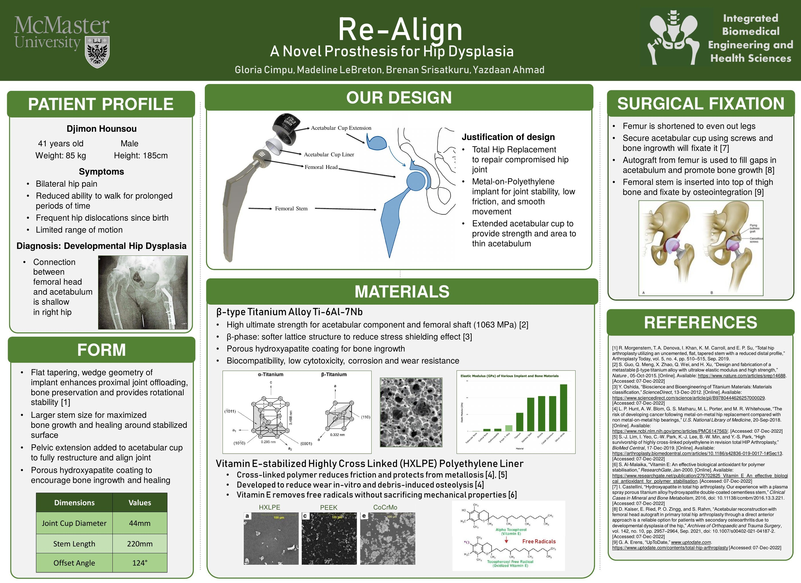
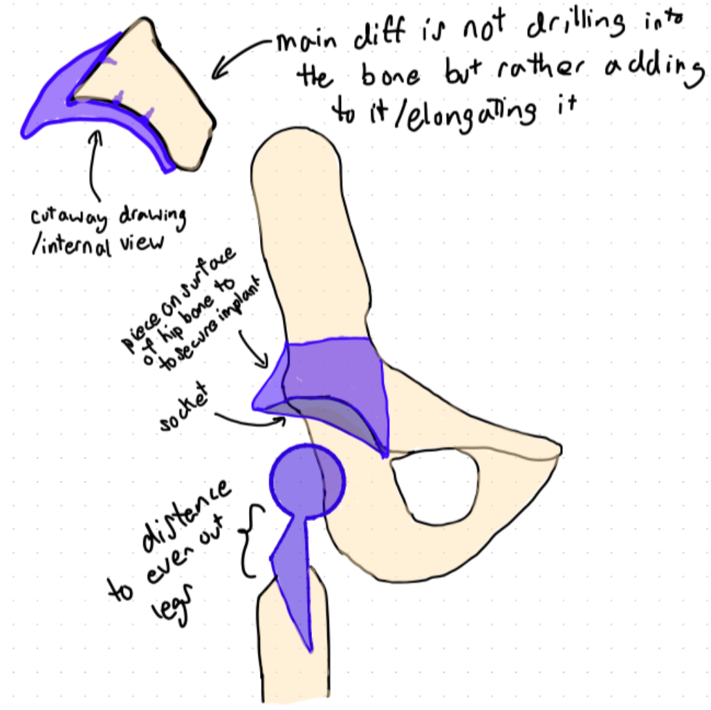
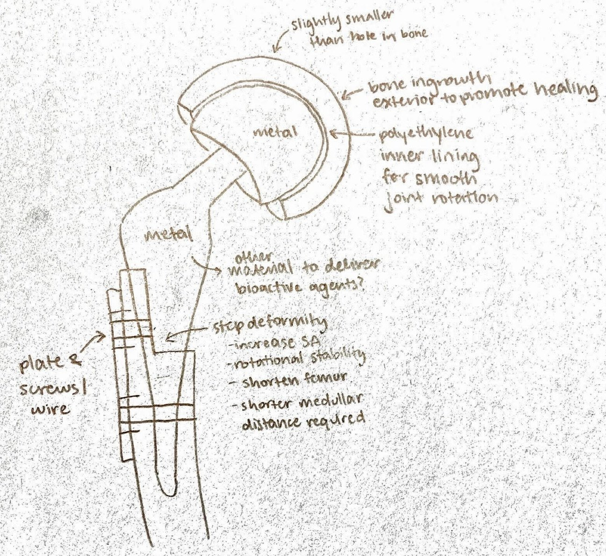
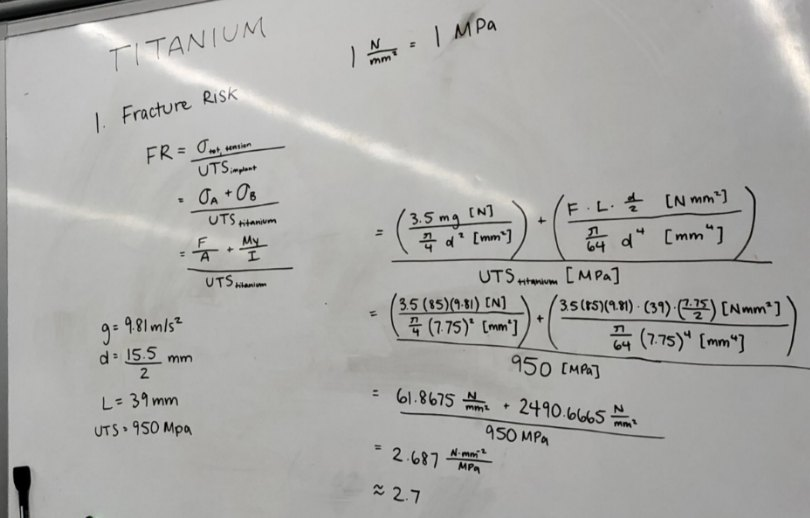
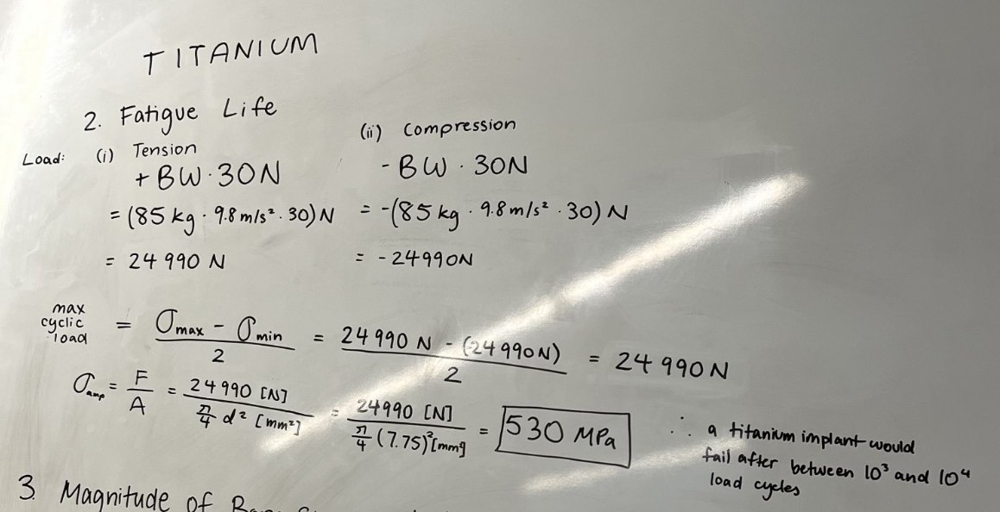
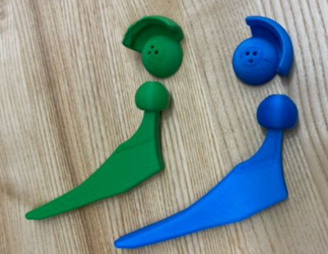

For the final project of Health Solutions Engineering Design Projects, our team designed an implant for a patient case with Developmental Hip Dysplasia, a condition of the femoral head and the acetabulum of the pelvis. The implant realigns the hips and promotes bone ingrowth.

[Open the poster as a PDF](/re-align-hip-prosthesis-poster.pdf)

## Design process

I started with preliminary research on the condition, then sketched the design to target the challenges of this patient case. The main difference from a standard replacement is that the implant adds to the bone, elongating it rather than drilling into it to even out the length of the patient's legs.

## Materials selection

I did the calculations for the metal of the acetabular component and the femoral stem. The choice was a β-type titanium alloy, Ti-6Al-7Nb, for its high ultimate strength, which gives a low fracture risk, and its softer cubic lattice phase, which reduces stress shielding. A porous hydroxyapatite coating promotes bone ingrowth. I worked out the fracture risk, the fatigue life and the magnitude of bone stress reduction from material property formulas, and compared metals and ceramics, with longevity and stress shielding in mind.

For the liner I chose vitamin E-stabilized, highly cross-linked polyethylene (HXLPE). It reduces friction in the liner, which protects against metallosis, and produces far fewer wear particles than competing materials, which prevents debris-induced osteolysis.

## Prototyping

I 3D printed the parts to check the design. I had to reconsider the scale and orientation of the prints to keep them stable while printing.

