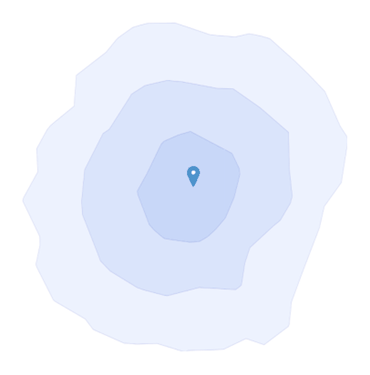
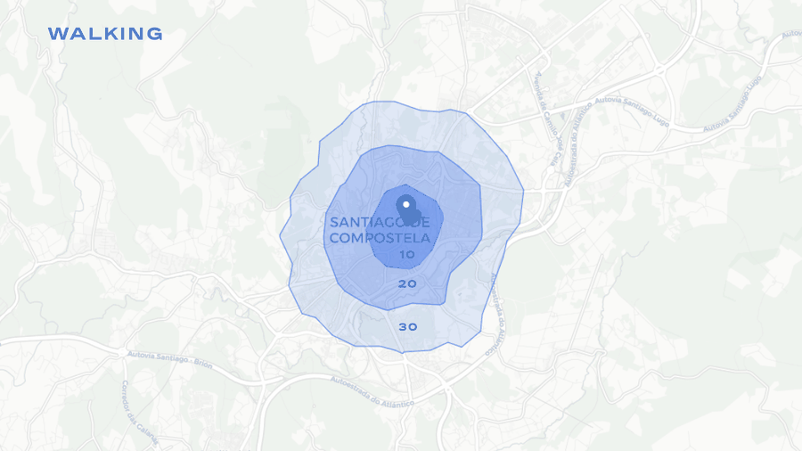
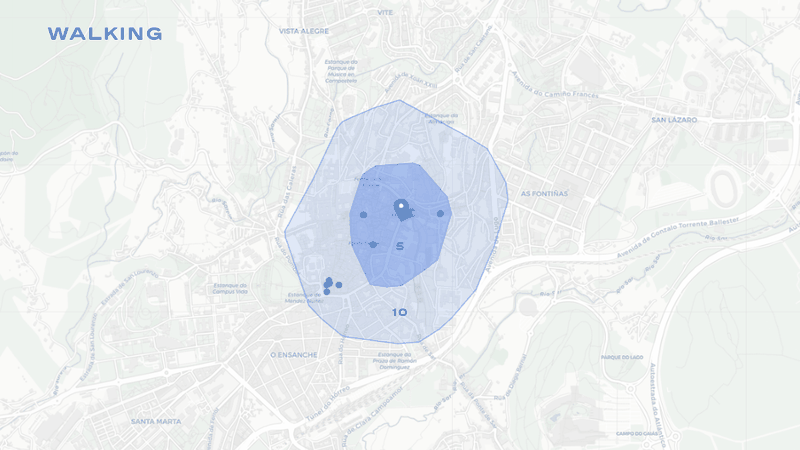
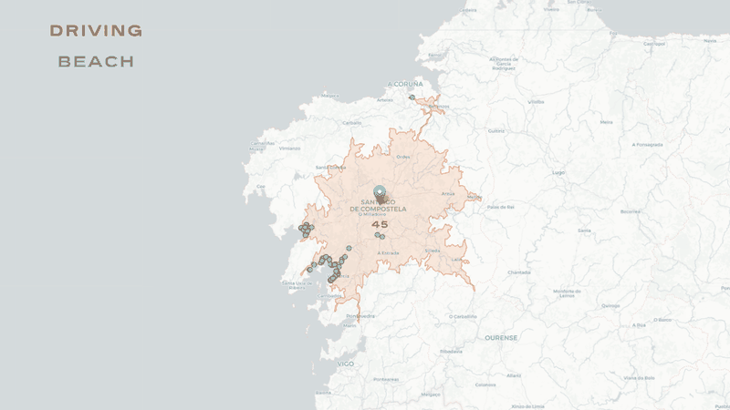
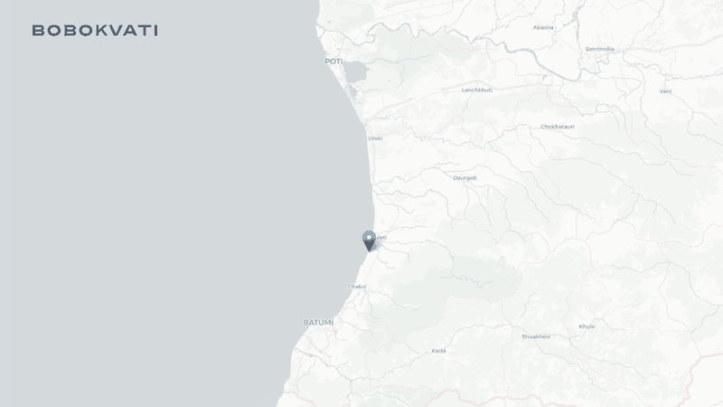

An interactive R Shiny tool that answers spatial accessibility questions for non-technical users. Click a point on the map (or search an address), pick travel modes and OpenStreetMap amenities, and the app draws travel-time isochrones, overlays the amenities that fall inside them, and exports everything as a QGIS-ready GeoPackage.

<video controls muted loop playsinline preload="metadata" poster="/video/isochrones-demo-poster.jpg" aria-label="Screen recording of the app: entering isochrone times of 5, 10 and 15 minutes, choosing walking, cycling and driving, picking pharmacies, then generating a map of travel-time areas and named pharmacies with a layer control to toggle each mode" style="aspect-ratio:2.216">
<source src="/video/isochrones-demo.mp4" type="video/mp4" />
</video>

Demo: setting isochrone times and travel modes, choosing pharmacies as the amenity, then generating the map and toggling each mode with the layer control.

## Why I built it

I built it during my internship at Fundación RIA so that architects could run accessibility analyses for site and exhibition research without writing code or opening a GIS.

## Features

- **Two ways to set an origin:** click the map, or geocode an address with OpenStreetMap Nominatim.
- **Isochrones for walking, cycling and driving,** computed with the OpenRouteService API. Any combination of modes and up to 10 time thresholds (for example 5, 10, 15 minutes). Requests are checked against OpenRouteService's per-mode range limits.
- **Amenity overlay from OpenStreetMap:** 20 presets (schools, pharmacies, supermarkets, parks, bus stops and more) or any custom `key=value` OSM tag, such as `amenity=veterinary`.
- **Reachability attribute per amenity:** each amenity is tagged with the smallest time band that contains it, per mode (`walk_min`, `bike_min`, `drive_min`).
- **Readable map:** one colour per mode, ring opacity scaled by travel time, a layer control to toggle each mode and each amenity type, optional name labels, and a "named amenities only" filter to cut duplicates.
- **One-click export:** a single `.gpkg` with `isochrones`, `amenities` and `origin_point` layers, ready to open in QGIS.

## How it works

The workflow is shown in the diagram below. The origin comes from a map click or a Nominatim search. OpenRouteService returns isochrone polygons for each mode, and the bounding box of those polygons is used to fetch amenities for each OSM tag from Overpass (through `osmdata` and `callr`). A spatial join then assigns each amenity to the smallest time band that contains it, and the result is drawn on a Leaflet map or exported as a GeoPackage.

, generate isochrone polygons per travel mode (OpenRouteService), fetch amenities per OSM tag (Overpass via osmdata and callr), join each amenity to its smallest time band, then show a Leaflet map or export a GeoPackage for QGIS.")

The core logic is kept separate from the interface. A helpers file holds the functions for geocoding an address, parsing the time list, clamping times to each travel mode's limits, requesting isochrones, fetching amenities and assigning time bands. The Shiny interface (a bslib sidebar layout) handles the reactive state for origin, isochrones and amenities, map drawing, the layer control and export.

## Using it

1. Set an origin by clicking the map or searching an address.
2. Enter isochrone times in minutes, comma-separated (default 5, 10, 15).
3. Choose one or more travel modes.
4. Pick amenities from the presets, or type a custom OSM `key=value` tag.
5. Press Generate map, toggle layers as needed, then download the `.gpkg`.

The map opens on Santiago de Compostela, Galicia, but the app works anywhere OpenStreetMap and OpenRouteService have coverage. To run it yourself you need R 4.1 or later and a free OpenRouteService API key, which the app reads from an environment variable and never stores in the code. Setup steps are in the repository.

## Limitations

- It relies on free public services (OpenRouteService, Nominatim and Overpass), so it is subject to their rate limits and usage policies. It is meant for interactive, small-scale use rather than bulk analysis.
- Amenity completeness depends on OpenStreetMap coverage in the area.

Map data © OpenStreetMap contributors. Routing by OpenRouteService. Basemap © CARTO. Released under the MIT licence.
