Lab and course work from my mechatronics degree at McMaster: embedded programming in C on a PIC16F887 microcontroller, a digital circuit taken from analysis through simulation to a working breadboard, and a controls lab balancing a ball on a beam with the live response plotted on a laptop. The code for the controls work is in my [Control systems repository on GitHub](https://github.com/madelinelebreton/control-systems).

## Introduction to Microcontroller Systems

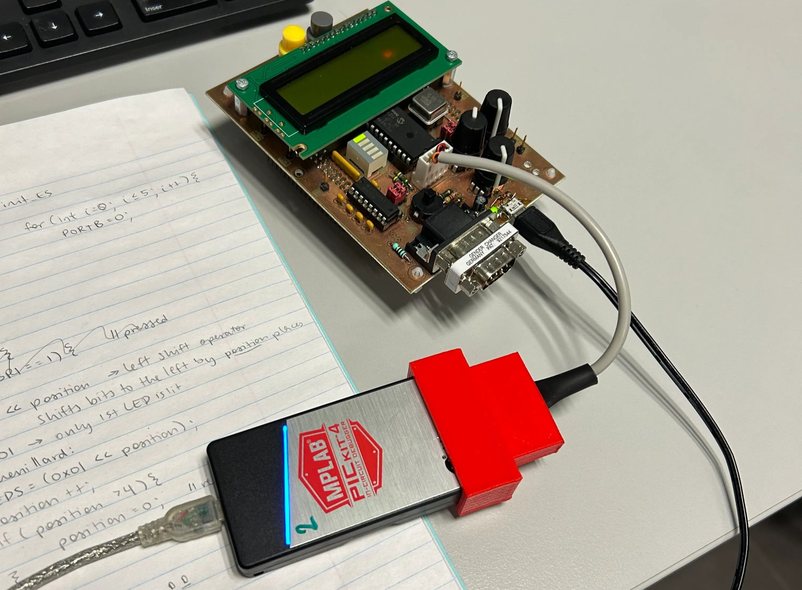

The course covered programming a PIC16F887 in C, including the standard peripherals (I/O, timers, the ADC and a serial link), the internal structure of a processor, and an introduction to interrupts.

<div class="two-col">
<div>

### Timer labs

**Timer Lab I** was a timed LED flasher on RB0, with a button to switch it on and off and a second button to choose the flashing frequency, 1 Hz or 5 Hz. **Timer Lab II** extended it to five LEDs on RB0 to RB4 flashing in an ordered pattern, with a button to pick the direction. The excerpt below is the helper that lights one LED and turns the other four off.

```c
// lights LED and turns off the other 4
void light_LED(short int LED){
    switch(LED){
        case 0: PORTB = 0; break;
        case 1: PORTB = 0x01; break; // LED 1 on
        case 2: PORTB = 0x02; break; // LED 2 on
        case 3: PORTB = 0x04; break; // LED 3 on
        case 4: PORTB = 0x08; break; // LED 4 on
        case 5: PORTB = 0x10; break; // LED 5 on
    }
}
```

</div>
<div>

### PedagoBot

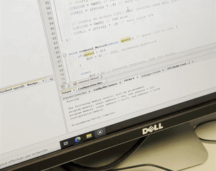

For the final project I programmed the PedagoBot robot to perform complex behaviour, using I/O ports, timers, PWM signals, interrupts, the ADC and the RS232 serial link together.

</div>
</div>

## Analog and Digital Circuits

This course covered how to design and analyze analog and digital circuits: component and circuit analysis and theorems, binary numbers, Boolean analysis and digital circuit design.

The final project was to simulate and build a sequential circuit that cycles through a student number.

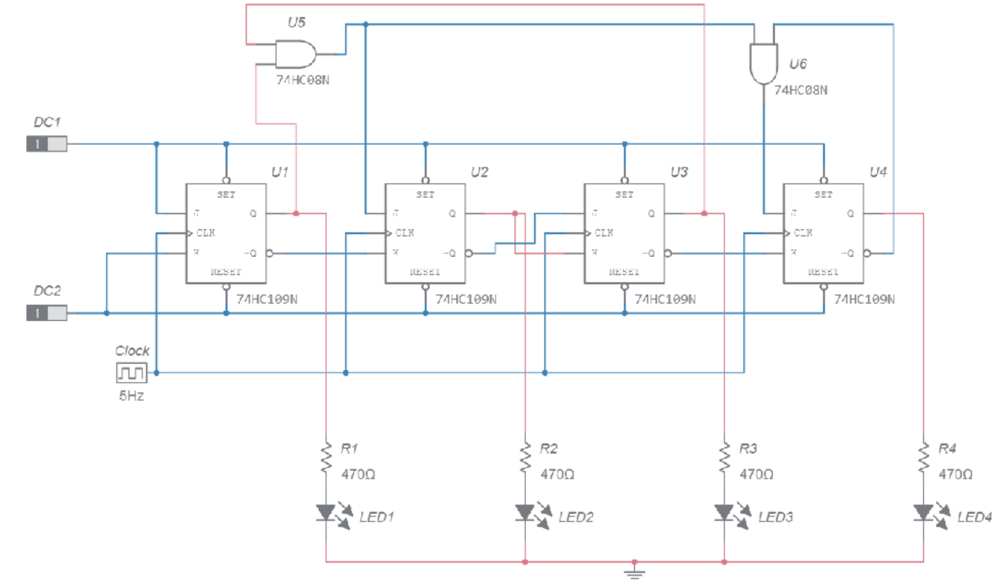

### Analysis

I solved the circuit analytically with sum-of-products expressions and Karnaugh maps for every JK input. That gave optimized truth tables for the JK flip-flops, a state transition table and an excitation table.

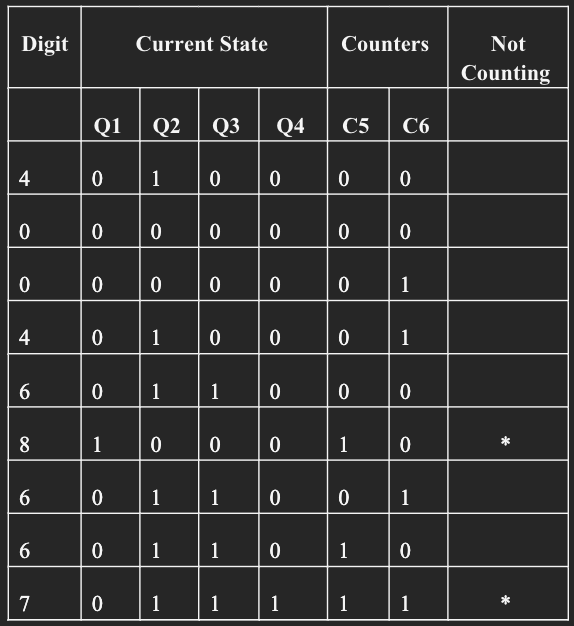
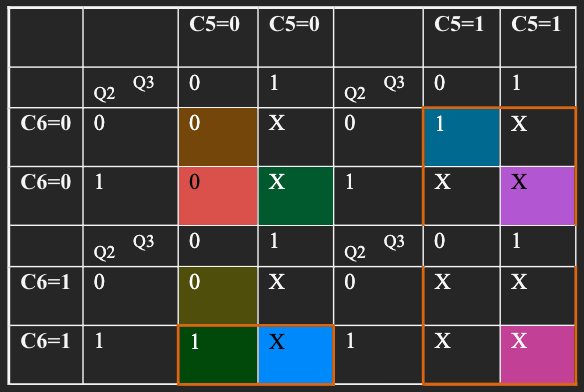

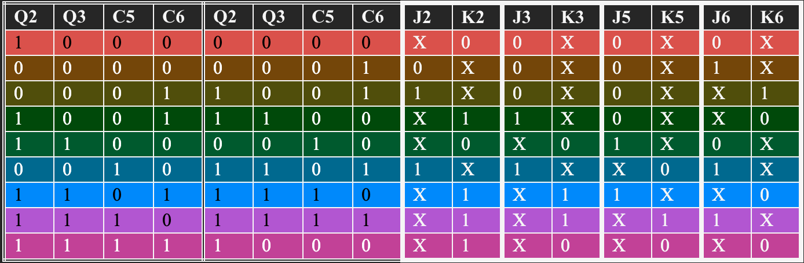
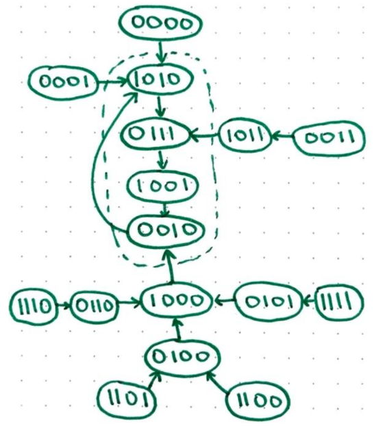

Next I drew the state transition diagram and a timing diagram of the finite state machine, to show how the clock pulses move it between states.

### Simulation

I simulated the circuit in Multisim to measure its output. The timing diagram matched the analytical solution.

<div class="stack-pair">

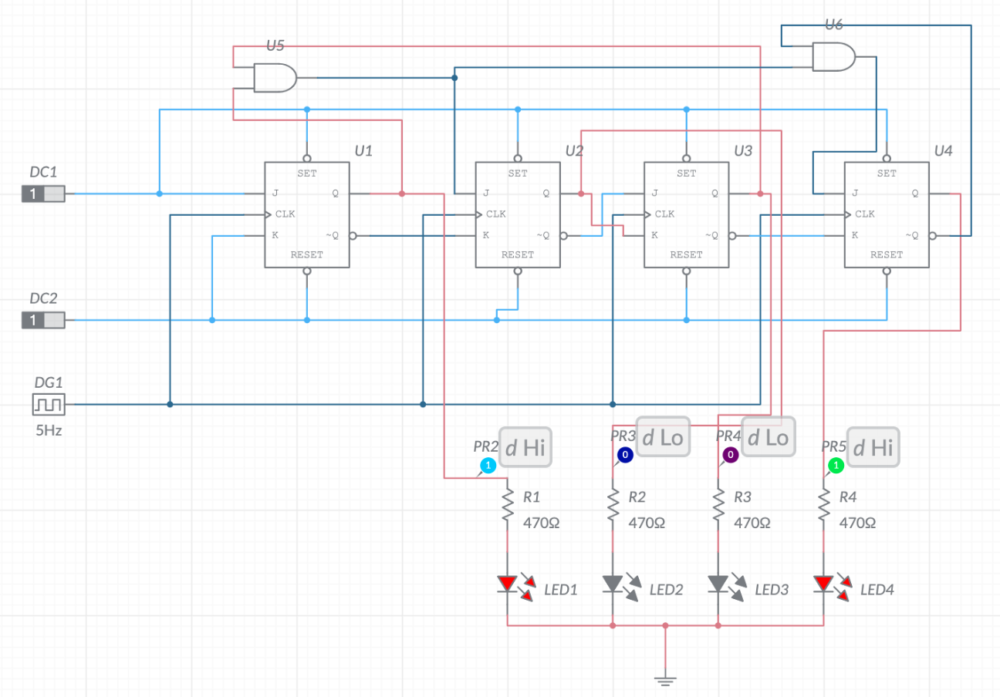

<div class="stack">

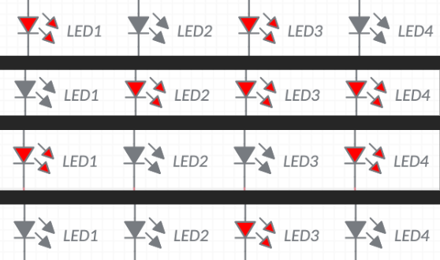

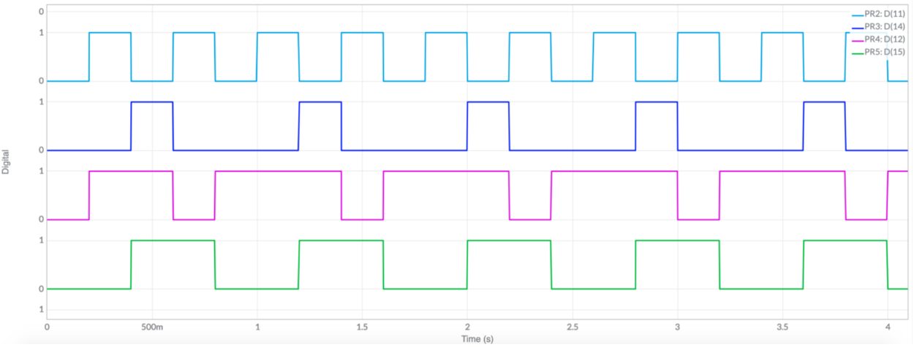

</div>
</div>

### Building it

I built the circuit on a breadboard with two dual JK flip-flop chips (74HC109N) and one quad AND chip (74HC08), wiring the inputs and outputs to match. Then I tested it to check that it worked as designed.

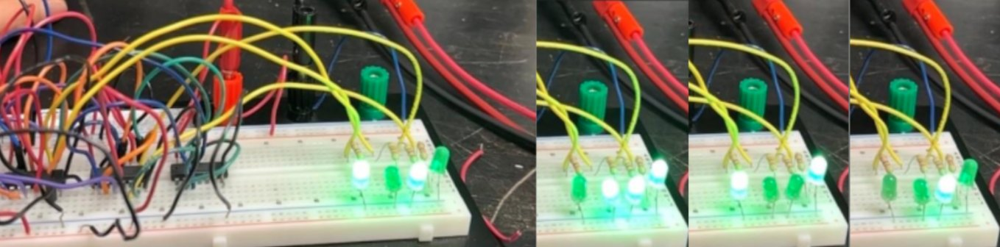
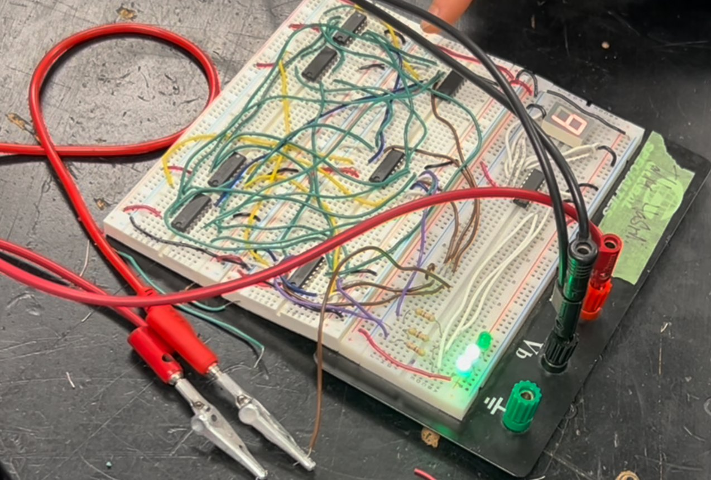

## Controls lab

In a controls lab I balanced a ball on a beam, with the response plotted live on a laptop (the animation at the top of this page). The photos below are from the labs around it.
