Research term in the Higgins Lab at McMaster, September to December 2023, with the nitrate reduction team. I collaborated on the Electrochemical Nitrate Reduction to Ammonia project, which develops atomically dispersed molecular catalysts as a sustainable alternative to the energy-intensive Haber–Bosch process. I also designed the journal cover and graphical abstracts for the papers below.

## The catalysts

The catalysts are copper-based porphyrin and phthalocyanine molecules: small macrocycles with a metal atom held at the centre by four nitrogen atoms. I designed and synthesized copper-based porphyrin and phthalocyanine catalysts, and tailored their molecular structures to improve current density (>150 mA/cm²) and stability (<5% degradation after 24 h). I also did literature research on phthalocyanine catalysts to guide those choices.

 are where a metal atom, copper in our case, is added in the middle.")
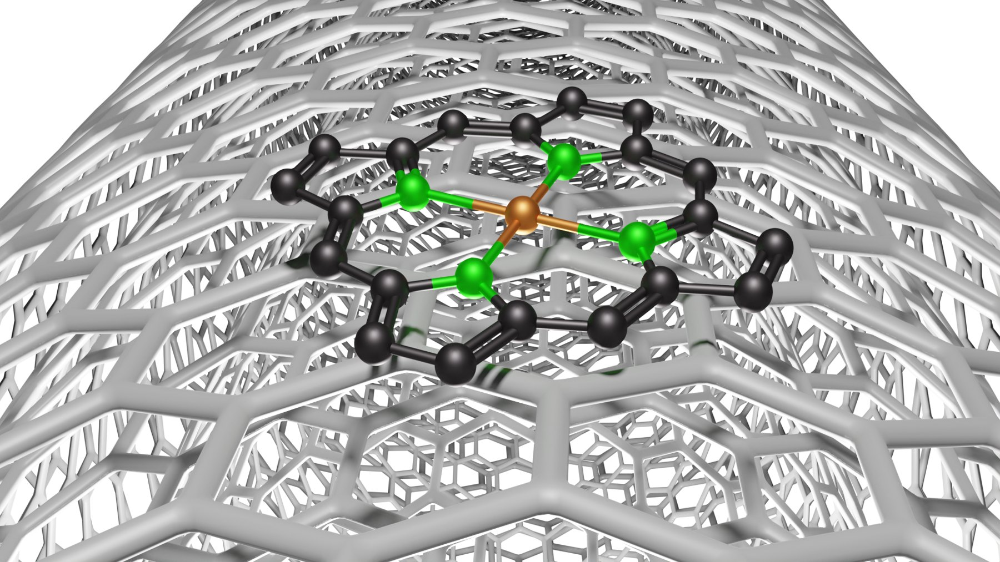

## Running the experiments

I carried out H-cell nitrate-to-ammonia electrolysis experiments. In an H-cell the cathode and anode sit in separate compartments joined across a membrane, with a reference electrode alongside the cathode, an argon line and an acid trap. I modelled the experimental H-cell in Autodesk Inventor, and the model appears in the Blender scenes I built for our figures.

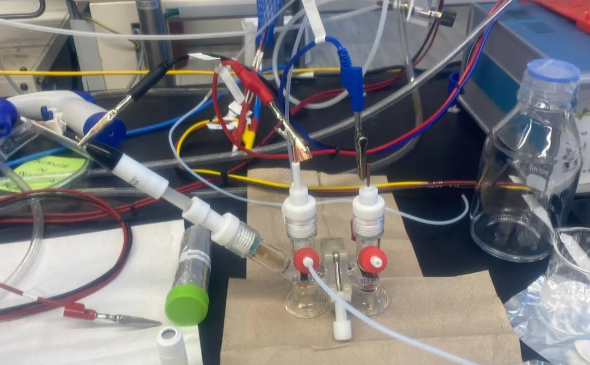
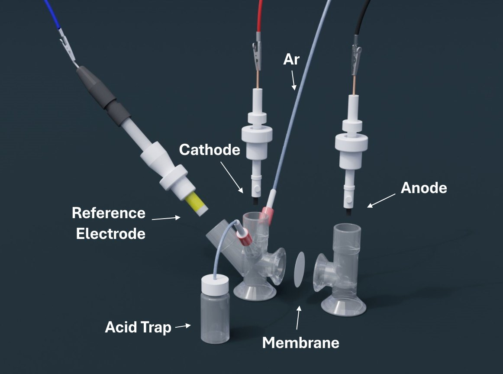
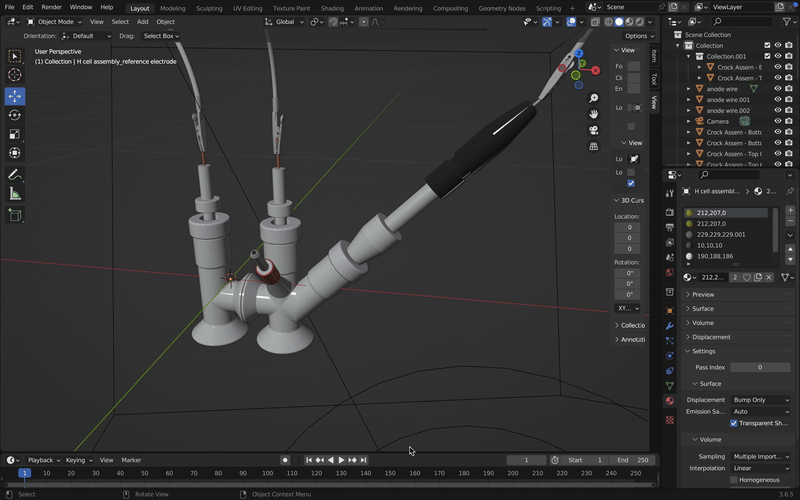

## Quantifying the products

I quantified the products by UV/Vis spectroscopy and Nuclear Magnetic Resonance (NMR) and calculated Faradaic efficiencies. I then analyzed the experimental data to work out how the active sites affect the reaction mechanism and the selectivity of the products.

Because the samples are colourless, I labelled and colour coded every vial, which taught me the importance of meticulous organization. I also took careful notes to learn from my own mistakes and those of my colleagues, so that errors were not repeated.

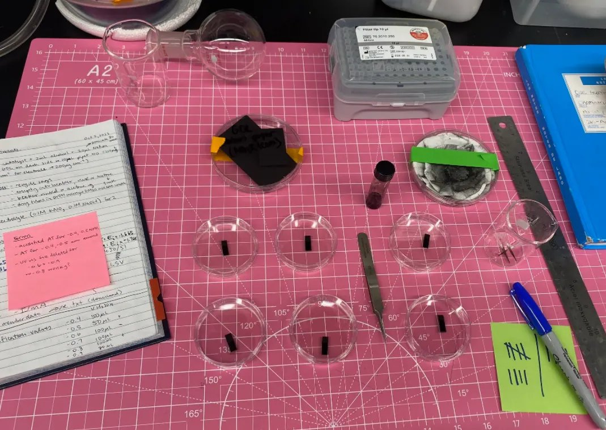
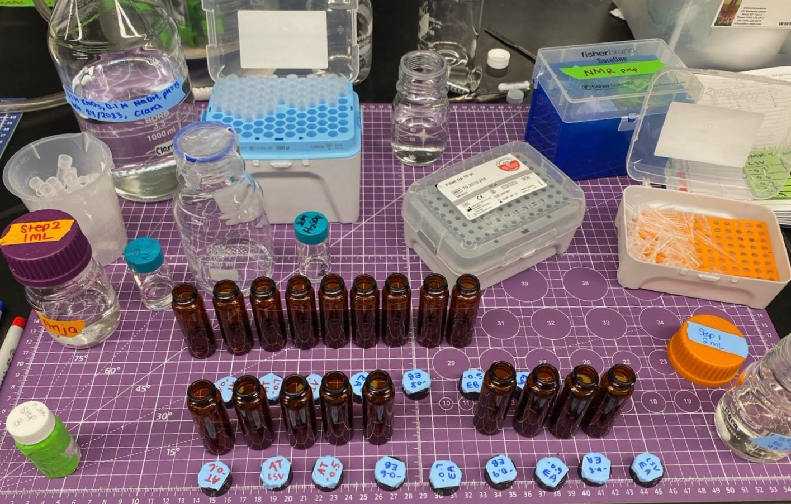
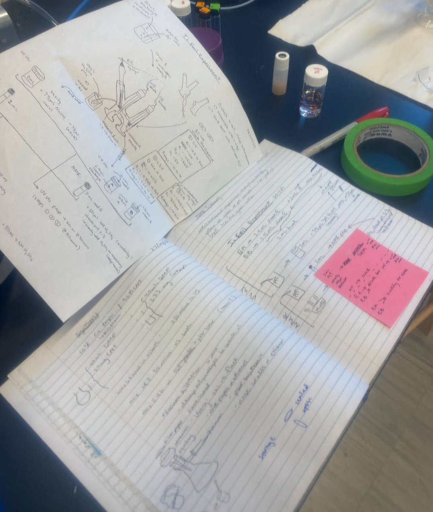

## Computational models and figures

I developed computational models of catalyst structures and reaction pathways using Python and Blender. I wrote a Python script that reads a molecule's atom and bond lists from .sdf files and builds the 3D model in Blender: spheres for atoms (hydrogen smaller than the rest), the bonds between them, and a material for each element.

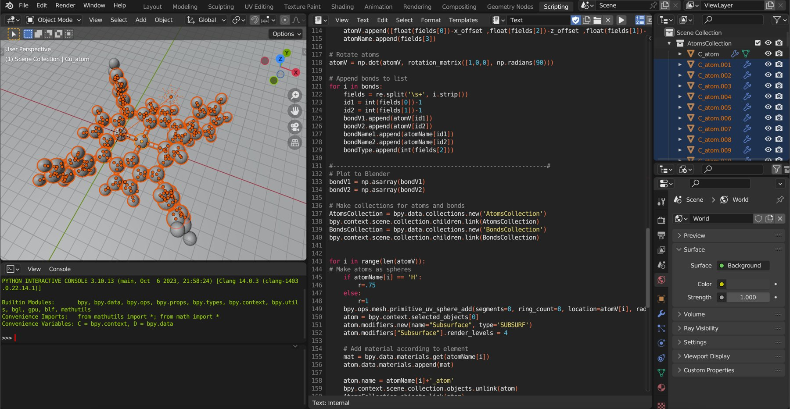
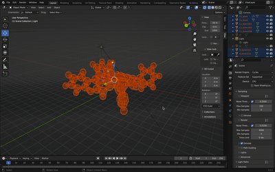

The script is public on GitHub as [molecule-scripting-blender](https://github.com/madelinelebreton/molecule-scripting-blender), with a README so that anyone can use it for their own molecules. It is adapted from the scripting approach in Jakob Kibsgaard's Blender course. It works through these steps:

1. Reads the atom and bond information from a `.mol` or `.sdf` structure file.
2. Extracts the atomic coordinates, element names and bond types.
3. Centres the structure on the origin and rotates it.
4. Creates a sphere for each atom and a cylinder for each bond.
5. Applies a material based on the elements involved.
6. Sorts the objects into an `AtomsCollection` and a `BondsCollection`.

Single, double and triple bonds are drawn as one, two or three parallel cylinders, offset sideways using a cross product. Each bond is built in two halves, one for each atom, so that it takes the colour of the element at either end:

```python
# Make bonds
for i in range(len(bondV1)):
    VectorDiff = bondV2[i]-bondV1[i]
    # Use cross product to make vector perpendicular to bond direction and z-axis
    delta = np.cross([VectorDiff[0],VectorDiff[1],VectorDiff[2]],[0,0,1])
    norm = np.linalg.norm(delta)
    delta = delta/norm*0.15

    for j in range(bondType[i]):
        # Make first half of bond
        makeHalfCylinder(bondV1[i]-delta*(bondType[i]-1-2*j),bondV2[i]-delta*(bondType[i]-1-2*j))
        bond = bpy.context.selected_objects[0]
        mat = bpy.data.materials.get(bondName1[i])
        bond.data.materials.append(mat)
        bond.name = bondName1[i]+'_bond'
        bpy.context.scene.collection.objects.unlink(bond)
        BondsCollection.objects.link(bond)
        # Make second half of bond: the same, from the other atom, with its material
```

To use it, download a structure file (for example from the Crystallography Open Database, or build one in Avogadro), set the file path at the top of the script, create Blender materials named after the element symbols (H, C, N, O), and run the script from Blender's Scripting workspace. For renders, Cycles gives higher quality and Eevee is faster for previews, and a transparent background can be turned on under Render, Film, Transparent.

The script produced the molecular models for the cover of ACS Catalysis, which I designed to illustrate the ideas of our work. I also used CAD to design the graphical abstract for a final publication.

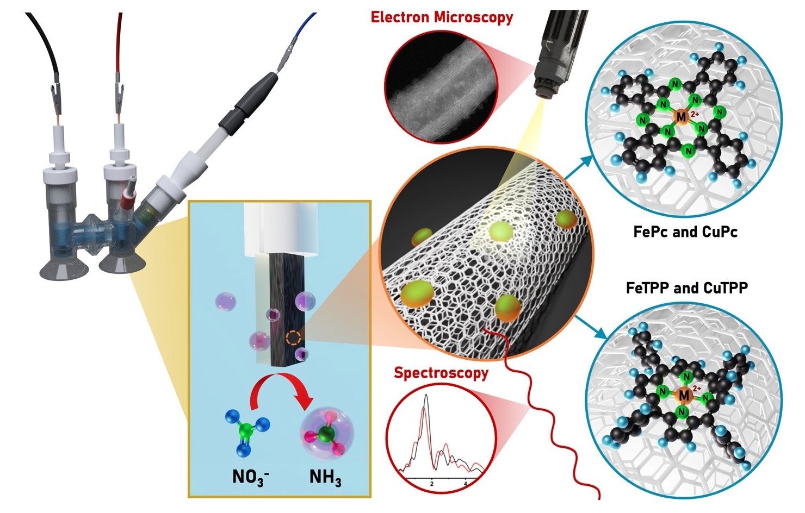
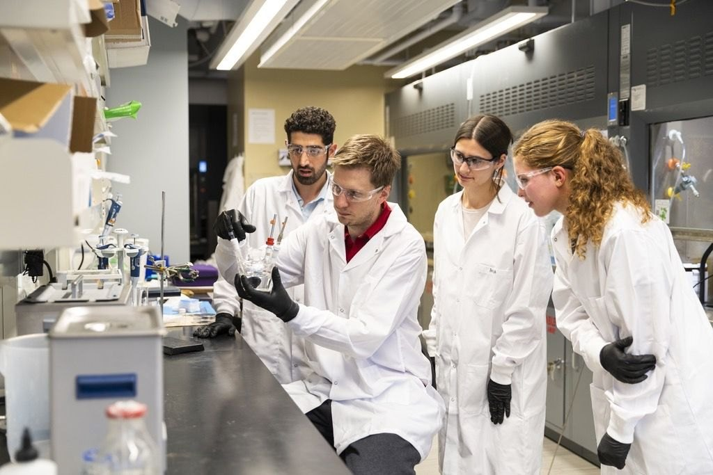
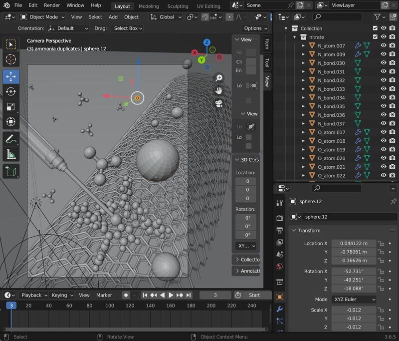

## What I learned

- Communicating scientific concepts in publications and presentations.
- Working in an interdisciplinary team, including collaborating with researchers at conferences to put their recommendations into practice.
- Becoming independent with my projects and working autonomously on experiments.
