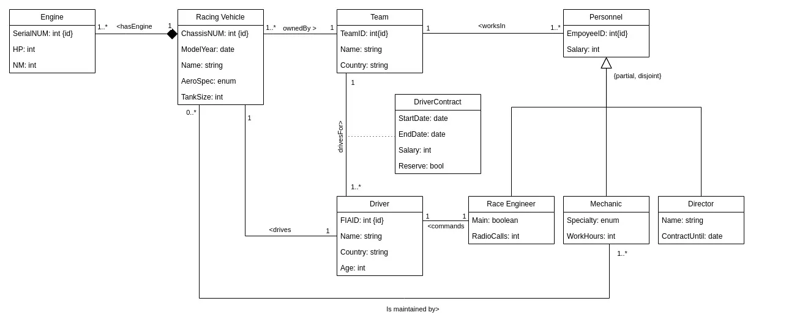
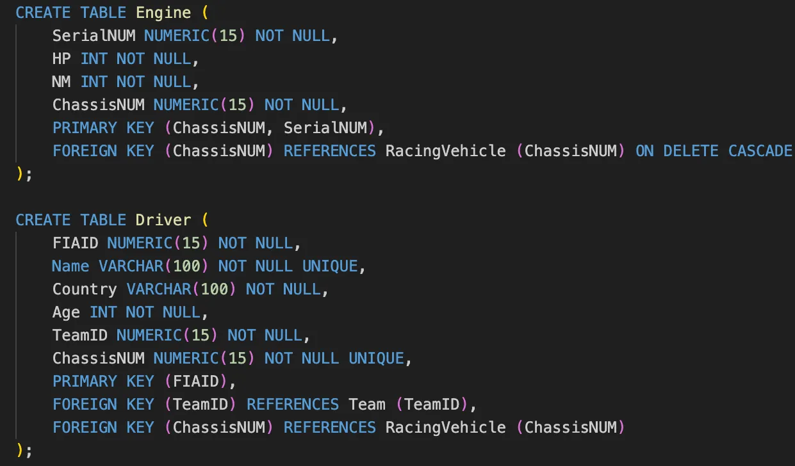

Three software courses from my mechatronics degree, each with a final project: a sentiment analysis tool in C, a dynamically resizable hash table in Java, and a relational database for a racing team.

## Programming for Mechatronics

Learned how to code in C, how to use the CPU and the memory hierarchy, and building fundamental data structures such as arrays, stacks and queues.

**[Final project:](https://github.com/madelinelebreton/algorithms-c/tree/main/sentiment-analysis-vader)** implement a lexicon and rule-based sentiment analysis tool in the style of VADER (Valence Aware Dictionary and sEntiment Reasoner). The program loads the lexicon into a dynamically sized array, splits sentences into words, and applies VADER's rules to calculate a score: exclamation points, all-caps words, intensifiers such as "very" and negations such as "not" each change the score of the word that follows. The scores are then normalized to a compound score between -1 and 1.

Each lexicon word is stored as a struct in a dynamically allocated array, and the boost factors for VADER's rules are constants:

```c
// constants for array size, boost factors, multipliers, normalization
#define ARRAY_SIZE 10
#define MAX_STRING_LENGTH 30 // changed because 5 was too short to accommodate some words in the lexicon
#define INTENSIFIER 0.293
#define EXCLAMATION 0.292
#define ALLCAPS 1.5
#define NEGATION -0.5
#define ALPHA 15

// data structure to read lexicon.txt and store each word's data in a structured
// format, dynamically allocating an array of WordData where each element
// corresponds to one lexicon word
typedef struct {
    char word[MAX_STRING_LENGTH]; // word in lexicon
    float value1;                 // mean sentiment value
    float value2;                 // stdev
    int intArray[ARRAY_SIZE];     // array of sentiment ratings
} WordData;
```

The core of the scoring is how a modifier carries over to the word that follows it. An intensifier or negation sets a flag, and the next word found in the lexicon has its score boosted or flipped, doubled up if the modifier was in all caps. At the end, the word scores are summed and divided by the root of the sum of squares to normalize them:

```c
// check if the current word is an intensifier or negation for the next word
if (isIntensifier(token)) {
    hasIntensifier = 1;
    if (isAllcaps(token)) hasAllcaps = 1;
} else if (isNegation(token)) {
    hasNegation = 1;
    if (isAllcaps(token)) hasAllcaps = 1;
}

if (wordScore != 0) { // word is in the lexicon
    // apply the all-caps modifier to the current word
    if (isAllcaps(token)) {
        wordScore *= ALLCAPS;
    }
    // if the previous word was an intensifier, apply it
    if (hasIntensifier) {
        if (hasAllcaps) {
            wordScore += wordScore * INTENSIFIER * ALLCAPS;
            hasAllcaps = 0;
        } else {
            wordScore += wordScore * INTENSIFIER;
        }
        hasIntensifier = 0; // reset after applying
    }
    // otherwise, if the previous word was a negation, apply it
    else if (hasNegation) {
        if (hasAllcaps) {
            wordScore += wordScore * NEGATION * ALLCAPS;
            hasAllcaps = 0;
        } else {
            wordScore += wordScore * NEGATION;
        }
        hasNegation = 0; // reset after applying
    }
    wordScores[wordCount] = wordScore; // store the modified score for the current word
}

// ... after the last word: normalize the compound score
if (sumSq != 0) {
    totalScore /= sqrt(sumSq);
}
```

## Data Structures and Algorithms

In this course I learned Java, through binary and multiway trees, heaps, stacks and queues.

**[Sample:](https://github.com/madelinelebreton/data-structures-java)** implemented a **dynamically resizable hash table** to store book names and 10-digit ISBN numbers. The hash uses the last three digits of the ISBN, collisions are handled by linear probing, and the table doubles in size when the load factor passes 0.70. Removing a book re-hashes the entries after it so that no holes break later lookups.

```java
// make the table bigger if it is getting full
private void resize() {
    Entry[] oldTable = table;          // save a copy of the old table
    int newSize = table.length * 2;    // double the size of the table
    table = new Entry[newSize];
    size = 0;                          // reset table size counter

    for (Entry e : oldTable) {
        if (e != null) {
            put(e.isbn, e.bookName);   // automatically increments size
        }
    }
}
```

## Database Foundations

This course covered what a database management system does, the common data models, the relational approach (algebra, SQL, normalization), transactions and database design. We studied schema design with the entity-relationship model and an algorithm for translating it into a normalized relational schema, and worked with SQL, JDBC and the Java API.

**[Final project:](https://github.com/madelinelebreton/racing-team-database)** a racing team management database, built with two teammates. Motor sport is growing worldwide, and racing teams are getting harder to manage. I started with a UML diagram of the classes and their relationships, including inheritance and decomposition, and considered the exceptions: drivers who change during the season, and reserve drivers.



Then I mapped the model to the relational model with relational algebra and wrote the final SQL: the schema, sample data for three teams, five queries without aggregates and three that need them.

<div class="align-bottom">
<div class="ab-text">

For example, to find the drivers who are reserves, I subtracted the drivers with a non-reserve contract from all drivers:

```sql
SELECT Driver.FIAID
FROM Driver
EXCEPT
SELECT DriverContract.FIAID
FROM DriverContract
WHERE Reserve = FALSE;
```

</div>



</div>

And to total the personnel salary of each team:

```sql
SELECT TeamID, SUM(Salary) AS TotalSalary
FROM Personnel
GROUP BY TeamID;
```
