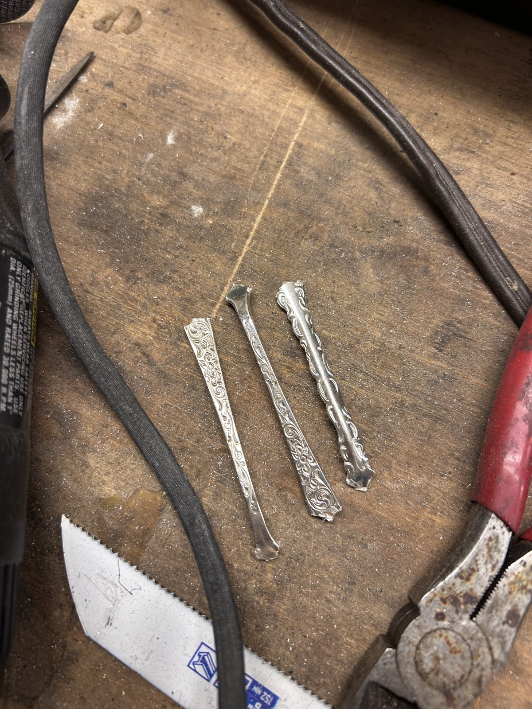
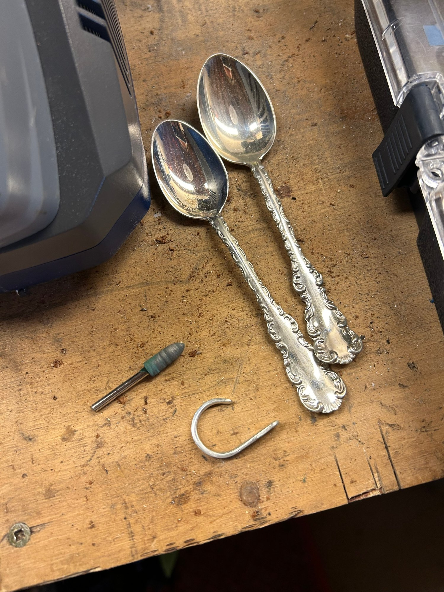
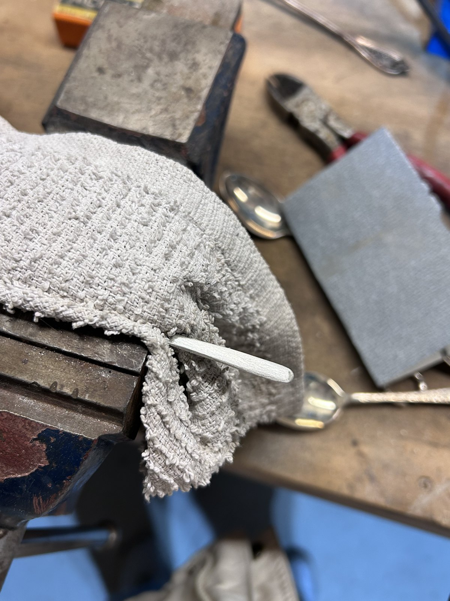
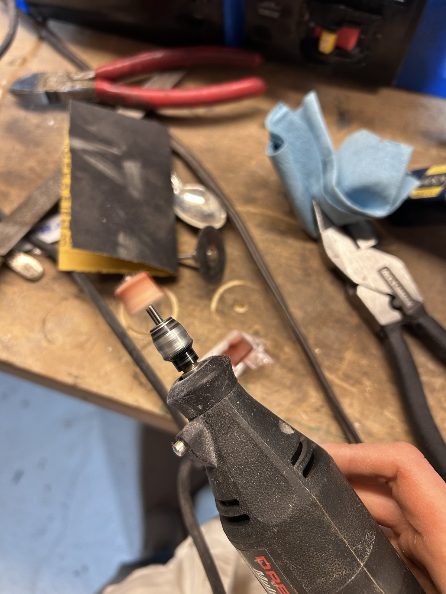
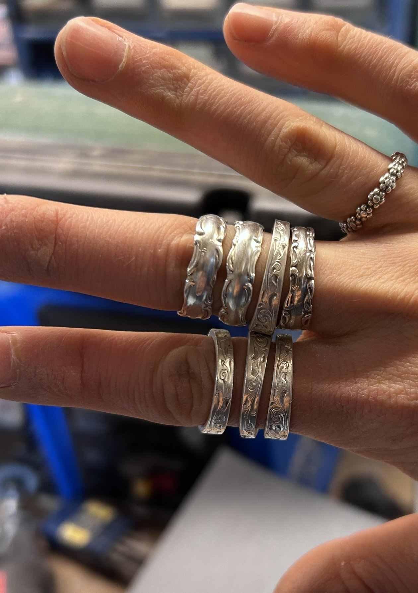

Turning heirloom silver spoons into custom rings. I have made over a dozen silver rings by cutting, shaping with a belt sander, bending according to a ring measurement tool, and polishing using a dremel tool.

