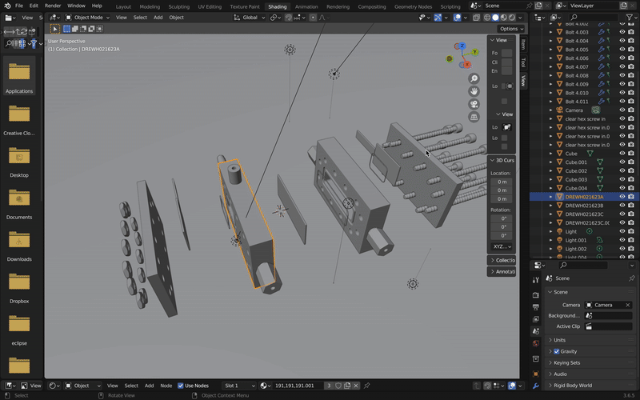
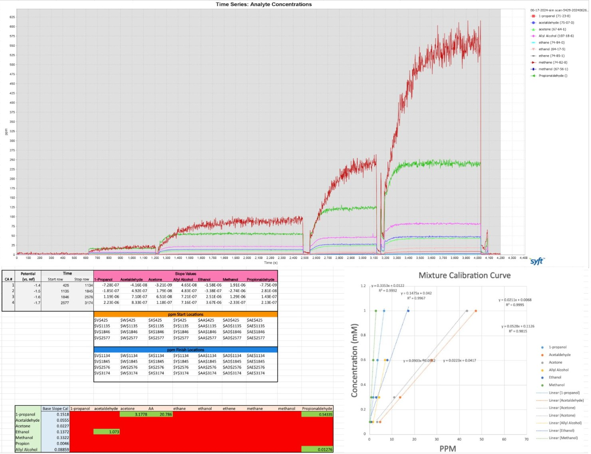
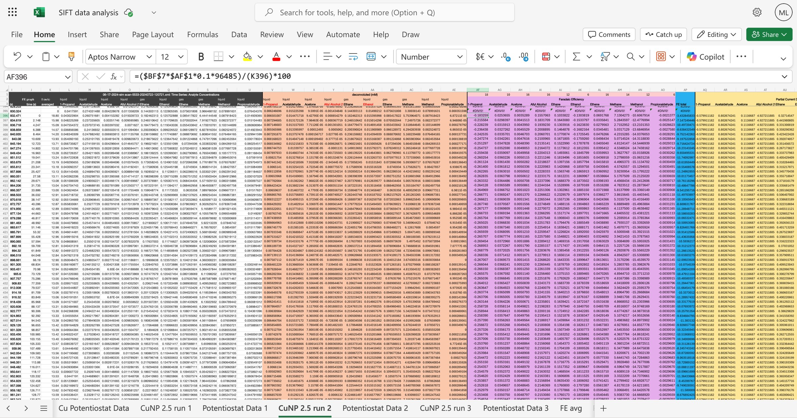
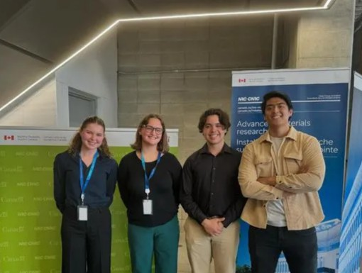
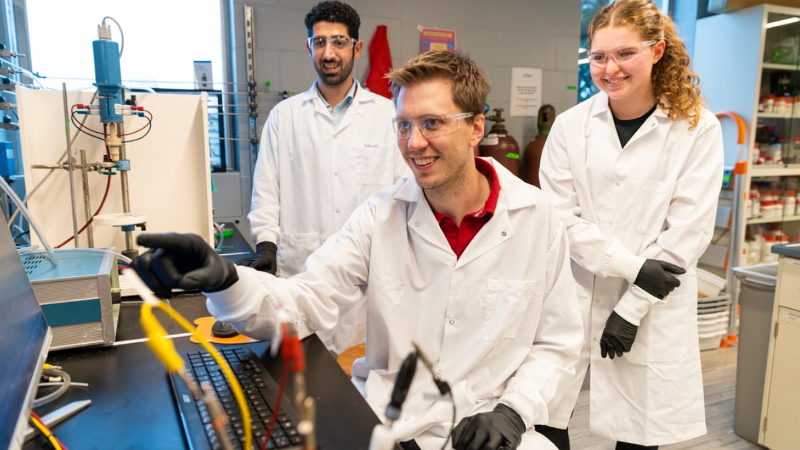

Summer 2024 I worked at the NRC's Advanced Materials Research Facility, funded by an NSERC Undergraduate Student Research Award. I helped develop a method to quantify the products of electrochemical CO₂ reduction in real time with a selected-ion flow-tube mass spectrometer (SIFT-MS). To test it, I ran 25 nm copper nanoparticle catalysts in a flow cell. The instrument read ten products, seven liquid and three gaseous, about every two seconds at four applied potentials.

NMR, HPLC and gas chromatography can't show how a catalyst changes over time, and they take hours to days to judge one catalyst. SIFT-MS reads products within seconds, so a catalyst can be watched while it runs. This would be useful in the search for catalysts that turn CO₂ into useful chemicals and fuels.

## Cell design

- **Modelled the two-compartment cell.** I built the experimental flow cell in Autodesk Inventor: two compartments separated by an anion exchange membrane, with working, counter and reference electrodes.
- **Fixed a leak.** The first design leaked, so I adapted it with an improved screwing mechanism.
- **Illustrations.** I made illustrations and computational models in CAD and Blender to explain catalyst structures and the setup in publications and presentations.

## Experiments and method

- **Experimental design.** I designed and validated the experimental methods using the scientific method.
- **Real-time measurement.** The headspace above the catholyte was sampled by the SIFT-MS to quantify seven liquid and three gaseous products, with a reading about every two seconds, while a potentiostat held the electrode at four applied potentials.
- **Repeatability.** The experiments were run three times to validate the results.
- **Efficiency and selectivity.** I executed experiments evaluating the efficiency and selectivity of the electrocatalysts, supported by data from real-time characterization.

## Data analysis

I processed over 10,000 real-time data points across ten products and four applied potentials, and improved the Excel workbook scripts that deconvolute signals into concentrations, production rates, Faradaic efficiencies and partial current densities. Several products give overlapping signals, so I used deconvolution formulae in Excel, built on calibration runs with known concentrations. In the final report, ethene reached a partial current density approaching 100 mA/cm² at the most negative potential tested.

## Presenting and sharing the work

- Wrote a final report on the findings and presented a poster at the McMaster Undergraduate Research Fair (embedded below). The study contributed to the paper linked below.
- Wrote an EndNote guide for students new to citation management, embedded below.

I worked alongside other undergraduate researchers in a multidisciplinary team, and with the CO₂ reduction team at the NRC. McMaster Engineering featured that team's work on a low-cost catalyst that converts CO₂ into carbon monoxide.

