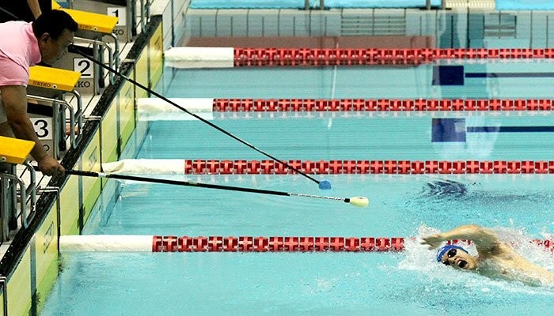

Swimmers with visual impairments risk hitting the wall at the end of a length, so they usually need a coach standing at the end of the lane with a tapper to warn them. For a biomedical engineering design challenge, our team of four built **SwimStinct**, a wearable device that senses the distance between the swimmer and the wall and communicates it through non-visual outputs, so the swimmer can turn or finish without a person tapping them. The animation above shows the device being verified in a simulated pool lane: the flags are distance markers and the black T in front of the wall.

## Design process

### Where to put the device

Early sketches worked out where the mechanism should sit, based on the orientation of the distance sensor and the swimmer's body position while swimming. I prototyped a clip that attaches to the swim cap or ear and the goggle strap.

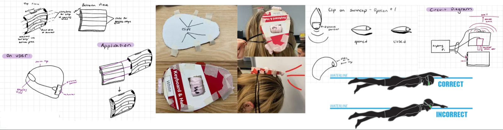
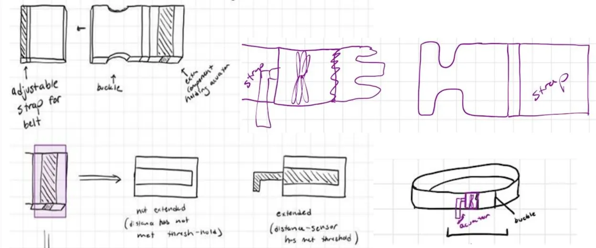

I also tried other locations on the body, including a chest strap that would tap on the skin. I dismissed it as over-complicated, and chose a dual output that combines a buzzer with a physical tap.

### Housing

I shaped the housing as a teardrop, inspired by the streamlined bodies of fish, to reduce drag. I designed the 3D printed assembly in AutoCAD Inventor.

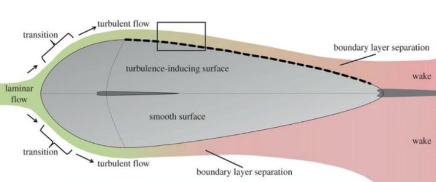
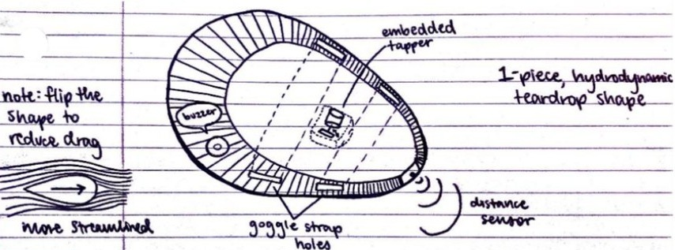

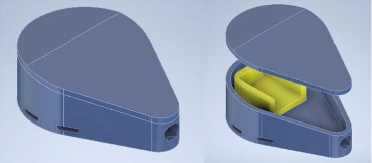
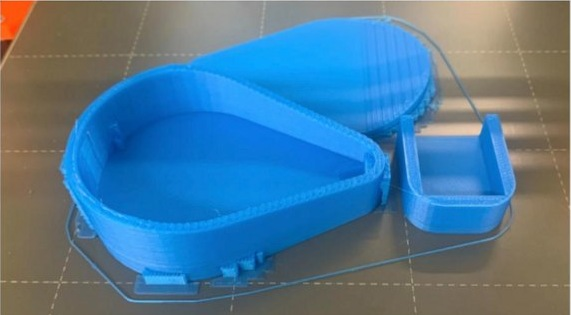

## An interview with a Paralympian

.")

To get an insider's view, we met Matt Cabraja, a blind Paralympic swimmer. Hearing the strengths and weaknesses of our device from him showed how well it suited a user's needs and directed the next iteration. He confirmed the need for a device that improves independence.

His main points were to:

1. make the device independent of the pool, so it is accessible to everyone,
2. wear it on the head, where swimmers are already comfortable with devices such as snorkels, tempo trainers and heart rate monitors, and
3. add personalized settings, because the distance at which a swimmer starts a flip turn depends on height and personal preference.

## Mechanism prototyping

The tap needs a motor's rotation converted to a linear motion. I prototyped the options.

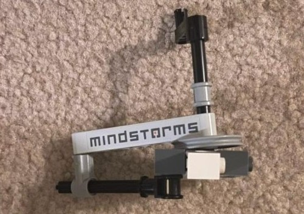
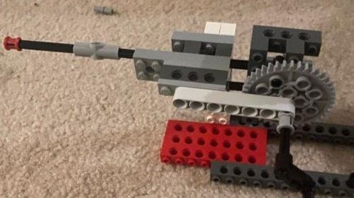
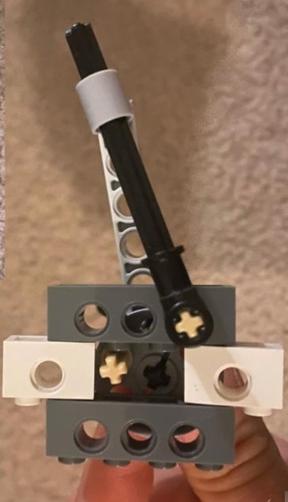

A revised mechanism used a zip tie as the flexible material, for a bigger range of motion. I tried several ways to convert the motor's rotation into a linear tap.

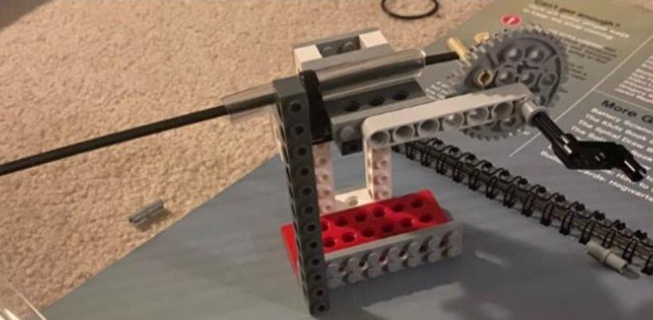
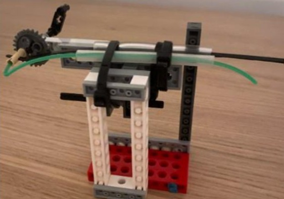

Then I assembled the 3D printed parts into a proof-of-concept linkage, with angle and mate constraints for the flexible zip tie.

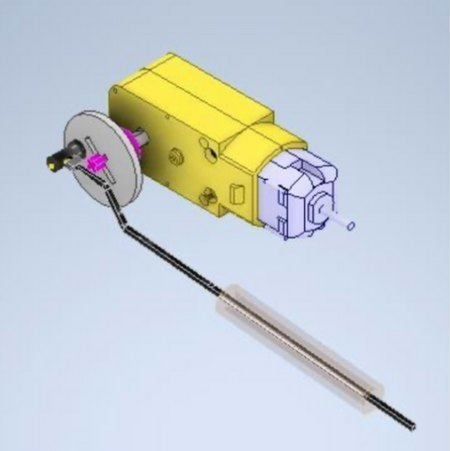
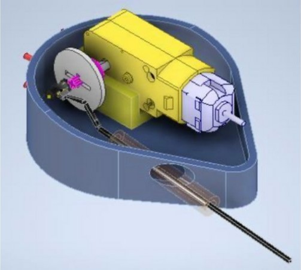
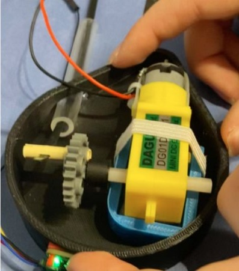

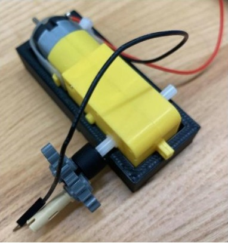
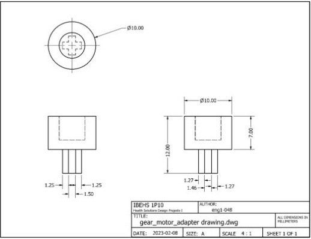
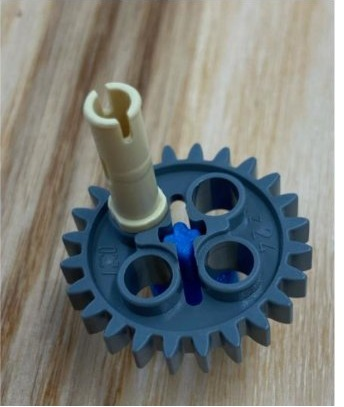
